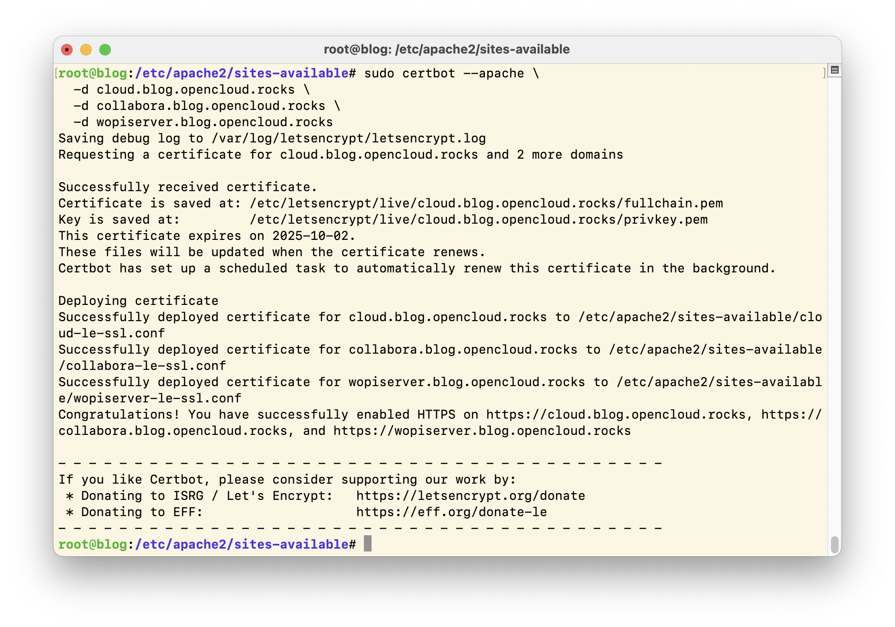
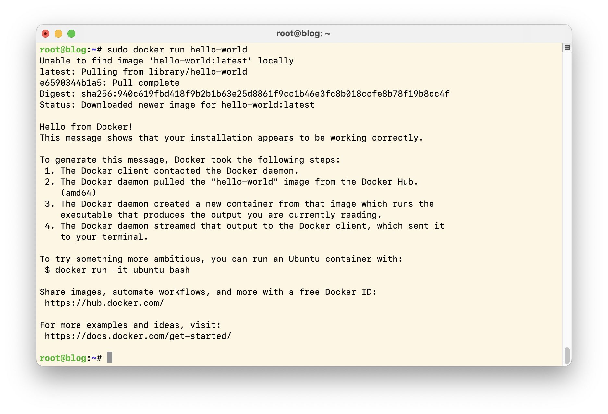
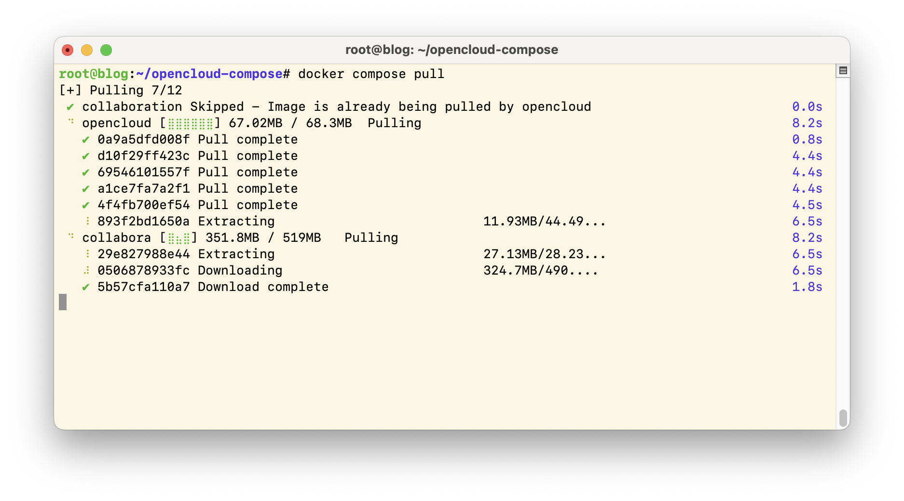
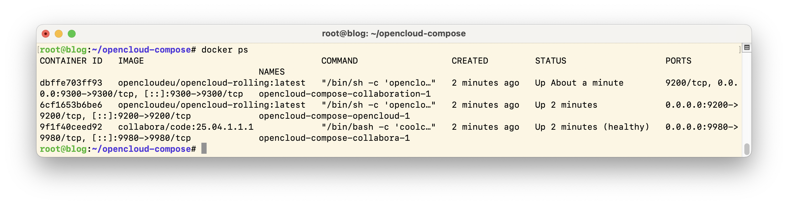
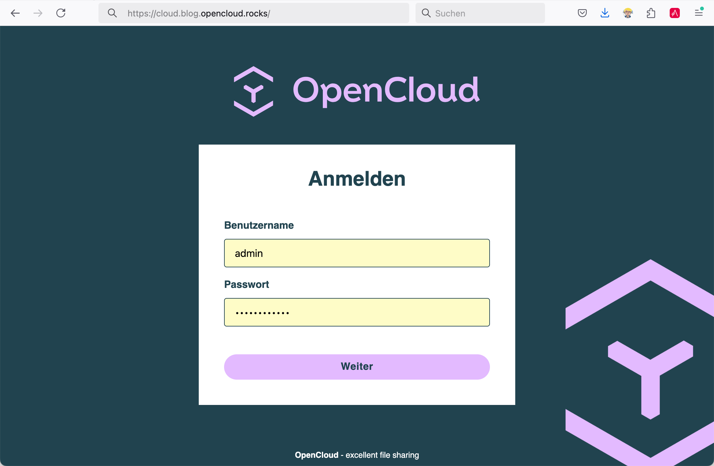
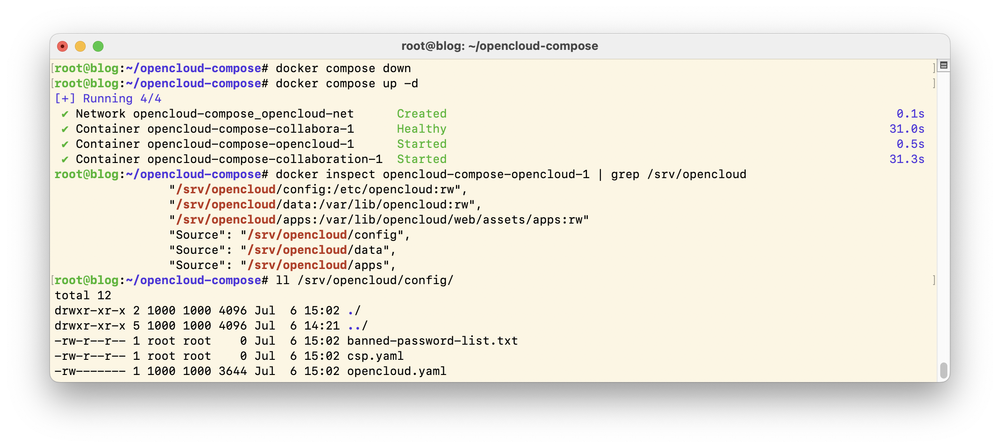

<!DOCTYPE html>
<!-- saved from url=(0082)https://opencloud.eu/de/opencloud-installieren-ganz-einfach-auf-dem-eigenen-server -->
<html lang="de" dir="ltr" prefix="og: https://ogp.me/ns#" class=" js"><head><meta http-equiv="Content-Type" content="text/html; charset=UTF-8">
    
<noscript>
</noscript><meta name="description" content="Sie möchten OpenCloud produktiv betreiben – mit eigener Domain, gültigen TLS-Zertifikaten und Weboffice? In diesem Artikel erfahren Sie Schritt für Schritt, wie Sie OpenCloud auf einem bestehenden Server einrichten und nahtlos in Ihre Infrastruktur integrieren.">
<meta name="keywords" content="OpenCloud, Open Source, Installationsanleitung">
<link rel="canonical" href="https://opencloud.eu/de/opencloud-installieren-ganz-einfach-auf-dem-eigenen-server">
<meta name="robots" content="index, follow">
<meta property="og:title" content="OpenCloud installieren – ganz einfach auf dem eigenen Server">
<meta name="twitter:card" content="summary">
<meta name="twitter:title" content="OpenCloud installieren – ganz einfach auf dem eigenen Server | OpenCloud">
<meta name="google-site-verification" content="JP-aRzNcGVOXzcEqKJOUVYfZ0KrW-6RK2lZci15P4EU">
<meta name="Generator" content="Drupal 11 (https://www.drupal.org); Commerce 3">
<meta name="MobileOptimized" content="width">
<meta name="HandheldFriendly" content="true">
<meta name="viewport" content="width=device-width, initial-scale=1.0">
<link rel="alternate" hreflang="de" href="https://opencloud.eu/de/opencloud-installieren-ganz-einfach-auf-dem-eigenen-server">
<link rel="alternate" hreflang="en" href="https://opencloud.eu/en/install-opencloud-simply-your-own-server">

    <title>OpenCloud installieren – ganz einfach auf dem eigenen Server | OpenCloud</title>
    <meta name="format-detection" content="telephone=no">
    <link rel="stylesheet" media="all" href="./opencloud_files/8628052440e532f890cfc00d4a682fa6.min.css">
<link rel="stylesheet" media="all" href="./opencloud_files/018b84b545f1b1c2d79f7133f25b94d5.min.css">
<link rel="stylesheet" media="all" href="./opencloud_files/bb97af618e143d699c9b1490259df7a2.min.css">
<link rel="stylesheet" media="all" href="./opencloud_files/da4ff6b7023d551cabc779c4ecd2514b.min.css">
<link rel="stylesheet" media="all" href="./opencloud_files/ac3a25c1a721ff659377d3b401a42f7d.min.css">
<link rel="stylesheet" media="all" href="./opencloud_files/e382578eb43cf75a084cec3d99e569b4.min.css">
<link rel="stylesheet" media="all" href="./opencloud_files/83e68dbaa6a9f95f657ec1759b8baabd.min.css">
<link rel="stylesheet" media="all" href="./opencloud_files/cd068c6fabd914c8903962e639ebecc3.min.css">
<link rel="stylesheet" media="all" href="./opencloud_files/6bf7857dc423eada40ddf4aec0506587.min.css">
<link rel="stylesheet" media="all" href="./opencloud_files/8ed3f14dc4200f10cbcc1279747bbe39.min.css">
<link rel="stylesheet" media="all" href="./opencloud_files/cfd869694de3e66f4725d0956056988f.min.css">
<link rel="stylesheet" media="all" href="./opencloud_files/a77c6ab7742585fc8266a5f41b392699.min.css">
<link rel="stylesheet" media="all" href="./opencloud_files/ccb5591b3a19d789a248e75fc4ece74f.min.css">
<link rel="stylesheet" media="all" href="./opencloud_files/dfda5a5a86af7c6beecc68f0a6d08746.min.css">
<link rel="stylesheet" media="all" href="./opencloud_files/5337f6782c333ee3190e9916d1d55945.min.css">
<link rel="stylesheet" media="all" href="./opencloud_files/f35450605bdf0bee93116139f5d55894.min.css">
<link rel="stylesheet" media="all" href="./opencloud_files/896397d7244d968ab59870c04eaf5a7f.min.css">
<link rel="stylesheet" media="all" href="./opencloud_files/aae05a69c245675a178190f88dedcc80.min.css">
<link rel="stylesheet" media="all" href="./opencloud_files/3e350199a1234c38c350d0e0b745854f.min.css">
<link rel="stylesheet" media="all" href="./opencloud_files/6a9f82db0544249bb4705bc6d8225d49.min.css">
<link rel="stylesheet" media="all" href="./opencloud_files/c01c446d9be3479da635580245cc6074.min.css">
<link rel="stylesheet" media="all" href="./opencloud_files/a16f52878f1bbc20fdb40221ab2cbef0.min.css">
<link rel="stylesheet" media="all" href="./opencloud_files/dc79bb759d046d4096b8e5372702b13d.min.css">
<link rel="stylesheet" media="all" href="./opencloud_files/e1f7ab429cddee3fecb9b6e737934741.min.css">
<link rel="stylesheet" media="all" href="./opencloud_files/8d27243922b47430224334c6e1eb8778.min.css">
<link rel="stylesheet" media="all" href="./opencloud_files/2035508b02955b46e32b798f0650f0c4.min.css">
<link rel="stylesheet" media="all" href="./opencloud_files/7209d68409ad265a9362dd9a4f121185.min.css">
<link rel="stylesheet" media="all" href="./opencloud_files/af93bb2070fe9014644c2dc51adeffe6.min.css">
<link rel="stylesheet" media="all" href="./opencloud_files/e22a7eb3794133e35a6134ee33e06a3d.min.css">
<link rel="stylesheet" media="all" href="./opencloud_files/b1c744b86376885f21081c9e97b3113c.min.css">
<link rel="stylesheet" media="all" href="./opencloud_files/0bc7570a128b32be9381159d37b2e84d.min.css">
<link rel="stylesheet" media="all" href="./opencloud_files/ff56b7b15b68a59722e867af540cc14f.min.css">

    

    <link rel="apple-touch-icon" sizes="180x180" href="https://opencloud.eu/themes/cloudy/src/assets/favicon/web-app-manifest-192x192.png">
    <link rel="apple-touch-icon" sizes="180x180" href="https://opencloud.eu/themes/cloudy/src/assets/favicon/web-app-manifest-512x512.png">
    <link rel="icon" type="image/png" href="https://opencloud.eu/themes/cloudy/src/assets/favicon/favicon-96x96.png" sizes="96x96">
    <link rel="icon" type="image/svg+xml" href="https://opencloud.eu/themes/cloudy/src/assets/favicon/favicon.svg">
    <link rel="shortcut icon" href="https://opencloud.eu/themes/cloudy/src/assets/favicon/favicon.svg" type="image/svg+xml">
    <link rel="manifest" href="https://opencloud.eu/themes/cloudy/src/assets/favicon/site.webmanifest">

    <meta name="theme-color" content="#ffffff">

            
      </head>
  <body>
        <a href="https://opencloud.eu/de/opencloud-installieren-ganz-einfach-auf-dem-eigenen-server#main-content" class="visually-hidden focusable">
      Direkt zum Inhalt
    </a>
    
      

    

  

    

  

    

      

        

          

<a href="https://opencloud.eu/de" class="logo ">
      <svg class="logo__svg" xmlns="http://www.w3.org/2000/svg" width="195" height="43" viewBox="0 0 847.73 179.09"><path d="M226.76,120.48c-12.96-7.31-20.51-20.74-20.51-37.59,0-8.48,1.77-16.03,5.42-22.63,7.07-13.2,20.51-20.98,37.36-20.98,8.37,0,15.67,1.89,22.16,5.54,12.85,7.42,20.27,21.09,20.27,38.06,0,8.37-1.77,15.91-5.3,22.39-7.07,13.08-20.51,20.74-37.12,20.74-8.37,0-15.79-1.77-22.27-5.54ZM248.92,112.46c16.5,0,27.34-11.55,27.34-29.58s-11.43-30.17-27.34-30.17-27.46,11.67-27.46,30.17,10.96,29.58,27.46,29.58Z" fill="#20434f"></path><path d="M310.48,62.26l7.78,13.67c7.07-11.2,16.38-13.67,23.57-13.67,5.77,0,10.72,1.3,15.08,4.12,4.48,2.95,7.9,6.72,10.14,11.43,2.47,4.95,3.65,10.37,3.65,16.38s-1.18,11.55-3.65,16.5c-2.24,4.71-5.78,8.49-10.25,11.2-4.24,2.83-9.19,4.12-14.97,4.12-3.89,0-7.78-.82-11.55-2.47-3.42-1.65-6.48-4.01-8.96-6.95v29.93h-14.38v-61.63l-8.84-15.44,12.37-7.19ZM321.33,94.2c0,3.65.71,7.07,2.12,10.02,1.77,3.18,3.77,5.42,6.13,6.84,2.71,1.53,5.66,2.24,9.07,2.24s6.48-.71,9.07-2.24c2.59-1.53,4.71-3.77,6.01-6.84,1.53-2.95,2.12-6.36,2.12-10.02,0-5.89-1.53-10.6-4.59-13.91-3.18-3.53-7.31-5.3-12.73-5.3-5.07,0-9.31,1.77-12.49,5.3-3.06,3.3-4.71,8.01-4.71,13.91Z" fill="#20434f"></path><path d="M382.08,77.82c2.36-4.71,5.89-8.6,10.72-11.67,4.95-2.71,10.37-4.01,16.62-4.01s11.43,1.3,15.56,3.77c4.48,2.83,7.78,6.6,10.14,11.31,2.12,4.83,3.3,10.61,3.3,16.97l-.23,3.42h-45.84c.47,5.3,2.36,9.31,5.66,12.37,3.3,2.59,7.66,3.77,12.85,3.77,4.01,0,7.54-.71,10.84-2,3.3-1.3,6.25-2.95,8.6-4.95.35.35,6.13,10.49,6.13,10.49-3.65,2.71-7.78,4.83-12.26,6.48-4.12,1.53-8.96,2.24-14.26,2.24-6.36,0-12.02-1.3-16.62-4.01-4.48-2.59-8.13-6.36-11.08-11.31-2.59-4.95-3.89-10.49-3.89-16.5s1.18-11.43,3.77-16.38ZM392.69,87.83h31.46c-.47-4.71-2-8.01-4.6-10.13-2.83-2.47-6.13-3.77-10.13-3.77s-7.66,1.3-10.84,3.54c-2.83,2.24-4.71,5.66-5.89,10.37Z" fill="#20434f"></path><path d="M508.5,87.36v36.77h-14.49v-35.47c0-4.83-1.06-8.25-3.3-10.49-2.12-2.59-5.3-3.77-9.66-3.77-2.83,0-5.19.71-7.54,2.24-2.24,1.18-4.01,3.18-5.19,5.66-1.06,2.36-1.77,5.19-1.77,8.6v33.23h-14.61v-39.24l-8.84-15.56,12.49-7.07,7.31,12.49c7.42-11.08,15.44-12.49,20.86-12.49,6.13,0,9.9,1.06,12.37,2.24,2.47,1.18,4.71,2.71,6.36,4.6,4.01,4.36,6.01,10.49,6.01,18.27Z" fill="#20434f"></path><path d="M585.22,120.95c-2.59,1.3-6.01,2.59-10.25,3.77-3.89.83-8.01,1.3-12.37,1.3-8.49,0-16.03-1.88-22.51-5.42-6.36-3.54-11.31-8.6-14.97-15.32-3.54-6.48-5.3-14.02-5.3-22.63s1.77-15.91,5.19-22.63c3.42-6.6,8.72-11.78,14.97-15.2,6.48-3.77,14.26-5.54,23.45-5.54,4.6,0,8.6.35,12.02,1.3,4.01.94,7.31,2.12,9.66,3.53,2.48,1.18,5.42,2.83,8.84,5.07l-7.43,12.61c-3.65-2.47-7.19-4.36-10.61-5.77-4.01-1.53-8.25-2.36-12.85-2.36-6.13,0-11.2,1.18-15.2,3.65-4.36,2.71-7.54,6.13-9.66,10.37-2.12,4.6-3.3,9.66-3.3,15.2s1.18,10.49,3.3,14.85c2.12,4.24,5.3,7.66,9.66,10.14,4.12,2.36,9.19,3.53,15.08,3.53,3.42,0,6.48-.35,9.31-1.06,3.06-.83,5.66-1.77,7.78-2.95,2.95-1.53,5.19-2.95,6.84-4.24l7.31,12.73c-3.53,2.12-6.48,3.89-8.96,5.07Z" fill="#20434f"></path><path d="M603,124.13V38.69h14.38v85.44h-14.38Z" fill="#20434f"></path><path d="M628.11,94.2c0-18.62,13.2-31.94,32.17-31.94s31.94,13.2,31.94,31.82-13.08,31.94-32.06,31.94-32.05-12.37-32.05-31.82ZM660.17,113.64c10.14,0,17.09-7.19,17.09-19.56s-6.95-19.56-17.09-19.56-17.21,7.9-17.21,19.56,6.84,19.56,17.21,19.56Z" fill="#20434f"></path><path d="M725.55,126.02c-6.95,0-12.49-2.12-16.73-6.72-4.01-4.59-6.01-10.84-6.01-18.62v-36.53h14.38v35.47c0,4.6,1.06,8.13,3.3,10.61,2.12,2.36,5.42,3.42,9.78,3.42,2.83,0,5.3-.59,7.54-1.89,2.24-1.3,3.89-3.3,5.07-5.77,1.3-2.59,1.88-5.54,1.88-8.6v-33.23h14.5v39.6l8.72,15.2-12.37,7.07-6.95-11.9s-2.71,3.54-6.36,6.6c-4.48,3.77-9.19,5.3-16.73,5.3Z" fill="#20434f"></path><path d="M776.31,77.82c2.71-5.3,5.89-9.19,10.25-11.43,4.36-2.71,9.43-4.24,14.85-4.24,4.6,0,8.37.94,11.67,2.59,3.3,1.65,6.36,3.77,8.84,6.95v-33h14.38v64.93l8.6,15.2-12.37,7.07-7.54-13.08s-5.19,7.31-11.9,10.61c-2.83,1.41-7.31,2.48-11.55,2.48-5.54,0-10.61-1.3-14.97-4.13-4.24-2.24-7.54-6.13-10.25-11.08-2.48-4.95-3.53-10.25-3.53-16.5s1.06-11.78,3.53-16.38ZM787.5,94.2c0,4.01.71,7.19,2.12,9.9,1.65,3.3,3.77,5.3,6.01,6.72,2.59,1.53,5.42,2.36,8.96,2.36s6.6-.83,9.07-2.36c2.47-1.41,4.59-3.54,6.13-6.72,1.42-2.71,2.12-5.89,2.12-9.9,0-5.89-1.53-10.84-4.83-13.91-2.83-3.53-7.19-5.42-12.37-5.42s-9.43,1.89-12.37,5.42c-3.3,3.06-4.83,8.01-4.83,13.91Z" fill="#20434f"></path><polygon points="69.63 129.25 76.91 125.05 76.91 94.64 103.09 79.52 103.09 71.14 95.81 66.94 69.46 82.15 43.47 67.15 36.19 71.35 36.19 79.73 62.37 94.85 62.37 125.06 69.63 129.25" fill="#20434f"></polygon><polygon points="136.44 41.4 69.64 2.83 69.64 2.84 69.64 2.83 2.83 41.4 2.83 58.19 69.64 19.62 136.44 58.19 136.44 41.4" fill="#20434f"></polygon><polygon points="136.44 120.9 69.64 159.47 2.84 120.9 2.84 137.69 69.64 176.26 69.64 176.25 69.64 176.26 136.44 137.69 136.44 120.9" fill="#20434f"></polygon></svg>
  
      <svg class="logo__mobile" xmlns="http://www.w3.org/2000/svg" width="200" height="45" viewBox="0 0 847.73 179.09"><path d="M226.76,120.48c-12.96-7.31-20.51-20.74-20.51-37.59,0-8.48,1.77-16.03,5.42-22.63,7.07-13.2,20.51-20.98,37.36-20.98,8.37,0,15.67,1.89,22.16,5.54,12.85,7.42,20.27,21.09,20.27,38.06,0,8.37-1.77,15.91-5.3,22.39-7.07,13.08-20.51,20.74-37.12,20.74-8.37,0-15.79-1.77-22.27-5.54ZM248.92,112.46c16.5,0,27.34-11.55,27.34-29.58s-11.43-30.17-27.34-30.17-27.46,11.67-27.46,30.17,10.96,29.58,27.46,29.58Z" fill="#20434f"></path><path d="M310.48,62.26l7.78,13.67c7.07-11.2,16.38-13.67,23.57-13.67,5.77,0,10.72,1.3,15.08,4.12,4.48,2.95,7.9,6.72,10.14,11.43,2.47,4.95,3.65,10.37,3.65,16.38s-1.18,11.55-3.65,16.5c-2.24,4.71-5.78,8.49-10.25,11.2-4.24,2.83-9.19,4.12-14.97,4.12-3.89,0-7.78-.82-11.55-2.47-3.42-1.65-6.48-4.01-8.96-6.95v29.93h-14.38v-61.63l-8.84-15.44,12.37-7.19ZM321.33,94.2c0,3.65.71,7.07,2.12,10.02,1.77,3.18,3.77,5.42,6.13,6.84,2.71,1.53,5.66,2.24,9.07,2.24s6.48-.71,9.07-2.24c2.59-1.53,4.71-3.77,6.01-6.84,1.53-2.95,2.12-6.36,2.12-10.02,0-5.89-1.53-10.6-4.59-13.91-3.18-3.53-7.31-5.3-12.73-5.3-5.07,0-9.31,1.77-12.49,5.3-3.06,3.3-4.71,8.01-4.71,13.91Z" fill="#20434f"></path><path d="M382.08,77.82c2.36-4.71,5.89-8.6,10.72-11.67,4.95-2.71,10.37-4.01,16.62-4.01s11.43,1.3,15.56,3.77c4.48,2.83,7.78,6.6,10.14,11.31,2.12,4.83,3.3,10.61,3.3,16.97l-.23,3.42h-45.84c.47,5.3,2.36,9.31,5.66,12.37,3.3,2.59,7.66,3.77,12.85,3.77,4.01,0,7.54-.71,10.84-2,3.3-1.3,6.25-2.95,8.6-4.95.35.35,6.13,10.49,6.13,10.49-3.65,2.71-7.78,4.83-12.26,6.48-4.12,1.53-8.96,2.24-14.26,2.24-6.36,0-12.02-1.3-16.62-4.01-4.48-2.59-8.13-6.36-11.08-11.31-2.59-4.95-3.89-10.49-3.89-16.5s1.18-11.43,3.77-16.38ZM392.69,87.83h31.46c-.47-4.71-2-8.01-4.6-10.13-2.83-2.47-6.13-3.77-10.13-3.77s-7.66,1.3-10.84,3.54c-2.83,2.24-4.71,5.66-5.89,10.37Z" fill="#20434f"></path><path d="M508.5,87.36v36.77h-14.49v-35.47c0-4.83-1.06-8.25-3.3-10.49-2.12-2.59-5.3-3.77-9.66-3.77-2.83,0-5.19.71-7.54,2.24-2.24,1.18-4.01,3.18-5.19,5.66-1.06,2.36-1.77,5.19-1.77,8.6v33.23h-14.61v-39.24l-8.84-15.56,12.49-7.07,7.31,12.49c7.42-11.08,15.44-12.49,20.86-12.49,6.13,0,9.9,1.06,12.37,2.24,2.47,1.18,4.71,2.71,6.36,4.6,4.01,4.36,6.01,10.49,6.01,18.27Z" fill="#20434f"></path><path d="M585.22,120.95c-2.59,1.3-6.01,2.59-10.25,3.77-3.89.83-8.01,1.3-12.37,1.3-8.49,0-16.03-1.88-22.51-5.42-6.36-3.54-11.31-8.6-14.97-15.32-3.54-6.48-5.3-14.02-5.3-22.63s1.77-15.91,5.19-22.63c3.42-6.6,8.72-11.78,14.97-15.2,6.48-3.77,14.26-5.54,23.45-5.54,4.6,0,8.6.35,12.02,1.3,4.01.94,7.31,2.12,9.66,3.53,2.48,1.18,5.42,2.83,8.84,5.07l-7.43,12.61c-3.65-2.47-7.19-4.36-10.61-5.77-4.01-1.53-8.25-2.36-12.85-2.36-6.13,0-11.2,1.18-15.2,3.65-4.36,2.71-7.54,6.13-9.66,10.37-2.12,4.6-3.3,9.66-3.3,15.2s1.18,10.49,3.3,14.85c2.12,4.24,5.3,7.66,9.66,10.14,4.12,2.36,9.19,3.53,15.08,3.53,3.42,0,6.48-.35,9.31-1.06,3.06-.83,5.66-1.77,7.78-2.95,2.95-1.53,5.19-2.95,6.84-4.24l7.31,12.73c-3.53,2.12-6.48,3.89-8.96,5.07Z" fill="#20434f"></path><path d="M603,124.13V38.69h14.38v85.44h-14.38Z" fill="#20434f"></path><path d="M628.11,94.2c0-18.62,13.2-31.94,32.17-31.94s31.94,13.2,31.94,31.82-13.08,31.94-32.06,31.94-32.05-12.37-32.05-31.82ZM660.17,113.64c10.14,0,17.09-7.19,17.09-19.56s-6.95-19.56-17.09-19.56-17.21,7.9-17.21,19.56,6.84,19.56,17.21,19.56Z" fill="#20434f"></path><path d="M725.55,126.02c-6.95,0-12.49-2.12-16.73-6.72-4.01-4.59-6.01-10.84-6.01-18.62v-36.53h14.38v35.47c0,4.6,1.06,8.13,3.3,10.61,2.12,2.36,5.42,3.42,9.78,3.42,2.83,0,5.3-.59,7.54-1.89,2.24-1.3,3.89-3.3,5.07-5.77,1.3-2.59,1.88-5.54,1.88-8.6v-33.23h14.5v39.6l8.72,15.2-12.37,7.07-6.95-11.9s-2.71,3.54-6.36,6.6c-4.48,3.77-9.19,5.3-16.73,5.3Z" fill="#20434f"></path><path d="M776.31,77.82c2.71-5.3,5.89-9.19,10.25-11.43,4.36-2.71,9.43-4.24,14.85-4.24,4.6,0,8.37.94,11.67,2.59,3.3,1.65,6.36,3.77,8.84,6.95v-33h14.38v64.93l8.6,15.2-12.37,7.07-7.54-13.08s-5.19,7.31-11.9,10.61c-2.83,1.41-7.31,2.48-11.55,2.48-5.54,0-10.61-1.3-14.97-4.13-4.24-2.24-7.54-6.13-10.25-11.08-2.48-4.95-3.53-10.25-3.53-16.5s1.06-11.78,3.53-16.38ZM787.5,94.2c0,4.01.71,7.19,2.12,9.9,1.65,3.3,3.77,5.3,6.01,6.72,2.59,1.53,5.42,2.36,8.96,2.36s6.6-.83,9.07-2.36c2.47-1.41,4.59-3.54,6.13-6.72,1.42-2.71,2.12-5.89,2.12-9.9,0-5.89-1.53-10.84-4.83-13.91-2.83-3.53-7.19-5.42-12.37-5.42s-9.43,1.89-12.37,5.42c-3.3,3.06-4.83,8.01-4.83,13.91Z" fill="#20434f"></path><polygon points="69.63 129.25 76.91 125.05 76.91 94.64 103.09 79.52 103.09 71.14 95.81 66.94 69.46 82.15 43.47 67.15 36.19 71.35 36.19 79.73 62.37 94.85 62.37 125.06 69.63 129.25" fill="#20434f"></polygon><polygon points="136.44 41.4 69.64 2.83 69.64 2.84 69.64 2.83 2.83 41.4 2.83 58.19 69.64 19.62 136.44 58.19 136.44 41.4" fill="#20434f"></polygon><polygon points="136.44 120.9 69.64 159.47 2.84 120.9 2.84 137.69 69.64 176.26 69.64 176.25 69.64 176.26 136.44 137.69 136.44 120.9" fill="#20434f"></polygon></svg>
  </a>
        

        

          

<a href="https://opencloud.eu/de" class="logo ">
      <svg class="logo__svg" xmlns="http://www.w3.org/2000/svg" width="195" height="43" viewBox="0 0 847.73 179.09"><path d="M226.76,120.48c-12.96-7.31-20.51-20.74-20.51-37.59,0-8.48,1.77-16.03,5.42-22.63,7.07-13.2,20.51-20.98,37.36-20.98,8.37,0,15.67,1.89,22.16,5.54,12.85,7.42,20.27,21.09,20.27,38.06,0,8.37-1.77,15.91-5.3,22.39-7.07,13.08-20.51,20.74-37.12,20.74-8.37,0-15.79-1.77-22.27-5.54ZM248.92,112.46c16.5,0,27.34-11.55,27.34-29.58s-11.43-30.17-27.34-30.17-27.46,11.67-27.46,30.17,10.96,29.58,27.46,29.58Z" fill="#20434f"></path><path d="M310.48,62.26l7.78,13.67c7.07-11.2,16.38-13.67,23.57-13.67,5.77,0,10.72,1.3,15.08,4.12,4.48,2.95,7.9,6.72,10.14,11.43,2.47,4.95,3.65,10.37,3.65,16.38s-1.18,11.55-3.65,16.5c-2.24,4.71-5.78,8.49-10.25,11.2-4.24,2.83-9.19,4.12-14.97,4.12-3.89,0-7.78-.82-11.55-2.47-3.42-1.65-6.48-4.01-8.96-6.95v29.93h-14.38v-61.63l-8.84-15.44,12.37-7.19ZM321.33,94.2c0,3.65.71,7.07,2.12,10.02,1.77,3.18,3.77,5.42,6.13,6.84,2.71,1.53,5.66,2.24,9.07,2.24s6.48-.71,9.07-2.24c2.59-1.53,4.71-3.77,6.01-6.84,1.53-2.95,2.12-6.36,2.12-10.02,0-5.89-1.53-10.6-4.59-13.91-3.18-3.53-7.31-5.3-12.73-5.3-5.07,0-9.31,1.77-12.49,5.3-3.06,3.3-4.71,8.01-4.71,13.91Z" fill="#20434f"></path><path d="M382.08,77.82c2.36-4.71,5.89-8.6,10.72-11.67,4.95-2.71,10.37-4.01,16.62-4.01s11.43,1.3,15.56,3.77c4.48,2.83,7.78,6.6,10.14,11.31,2.12,4.83,3.3,10.61,3.3,16.97l-.23,3.42h-45.84c.47,5.3,2.36,9.31,5.66,12.37,3.3,2.59,7.66,3.77,12.85,3.77,4.01,0,7.54-.71,10.84-2,3.3-1.3,6.25-2.95,8.6-4.95.35.35,6.13,10.49,6.13,10.49-3.65,2.71-7.78,4.83-12.26,6.48-4.12,1.53-8.96,2.24-14.26,2.24-6.36,0-12.02-1.3-16.62-4.01-4.48-2.59-8.13-6.36-11.08-11.31-2.59-4.95-3.89-10.49-3.89-16.5s1.18-11.43,3.77-16.38ZM392.69,87.83h31.46c-.47-4.71-2-8.01-4.6-10.13-2.83-2.47-6.13-3.77-10.13-3.77s-7.66,1.3-10.84,3.54c-2.83,2.24-4.71,5.66-5.89,10.37Z" fill="#20434f"></path><path d="M508.5,87.36v36.77h-14.49v-35.47c0-4.83-1.06-8.25-3.3-10.49-2.12-2.59-5.3-3.77-9.66-3.77-2.83,0-5.19.71-7.54,2.24-2.24,1.18-4.01,3.18-5.19,5.66-1.06,2.36-1.77,5.19-1.77,8.6v33.23h-14.61v-39.24l-8.84-15.56,12.49-7.07,7.31,12.49c7.42-11.08,15.44-12.49,20.86-12.49,6.13,0,9.9,1.06,12.37,2.24,2.47,1.18,4.71,2.71,6.36,4.6,4.01,4.36,6.01,10.49,6.01,18.27Z" fill="#20434f"></path><path d="M585.22,120.95c-2.59,1.3-6.01,2.59-10.25,3.77-3.89.83-8.01,1.3-12.37,1.3-8.49,0-16.03-1.88-22.51-5.42-6.36-3.54-11.31-8.6-14.97-15.32-3.54-6.48-5.3-14.02-5.3-22.63s1.77-15.91,5.19-22.63c3.42-6.6,8.72-11.78,14.97-15.2,6.48-3.77,14.26-5.54,23.45-5.54,4.6,0,8.6.35,12.02,1.3,4.01.94,7.31,2.12,9.66,3.53,2.48,1.18,5.42,2.83,8.84,5.07l-7.43,12.61c-3.65-2.47-7.19-4.36-10.61-5.77-4.01-1.53-8.25-2.36-12.85-2.36-6.13,0-11.2,1.18-15.2,3.65-4.36,2.71-7.54,6.13-9.66,10.37-2.12,4.6-3.3,9.66-3.3,15.2s1.18,10.49,3.3,14.85c2.12,4.24,5.3,7.66,9.66,10.14,4.12,2.36,9.19,3.53,15.08,3.53,3.42,0,6.48-.35,9.31-1.06,3.06-.83,5.66-1.77,7.78-2.95,2.95-1.53,5.19-2.95,6.84-4.24l7.31,12.73c-3.53,2.12-6.48,3.89-8.96,5.07Z" fill="#20434f"></path><path d="M603,124.13V38.69h14.38v85.44h-14.38Z" fill="#20434f"></path><path d="M628.11,94.2c0-18.62,13.2-31.94,32.17-31.94s31.94,13.2,31.94,31.82-13.08,31.94-32.06,31.94-32.05-12.37-32.05-31.82ZM660.17,113.64c10.14,0,17.09-7.19,17.09-19.56s-6.95-19.56-17.09-19.56-17.21,7.9-17.21,19.56,6.84,19.56,17.21,19.56Z" fill="#20434f"></path><path d="M725.55,126.02c-6.95,0-12.49-2.12-16.73-6.72-4.01-4.59-6.01-10.84-6.01-18.62v-36.53h14.38v35.47c0,4.6,1.06,8.13,3.3,10.61,2.12,2.36,5.42,3.42,9.78,3.42,2.83,0,5.3-.59,7.54-1.89,2.24-1.3,3.89-3.3,5.07-5.77,1.3-2.59,1.88-5.54,1.88-8.6v-33.23h14.5v39.6l8.72,15.2-12.37,7.07-6.95-11.9s-2.71,3.54-6.36,6.6c-4.48,3.77-9.19,5.3-16.73,5.3Z" fill="#20434f"></path><path d="M776.31,77.82c2.71-5.3,5.89-9.19,10.25-11.43,4.36-2.71,9.43-4.24,14.85-4.24,4.6,0,8.37.94,11.67,2.59,3.3,1.65,6.36,3.77,8.84,6.95v-33h14.38v64.93l8.6,15.2-12.37,7.07-7.54-13.08s-5.19,7.31-11.9,10.61c-2.83,1.41-7.31,2.48-11.55,2.48-5.54,0-10.61-1.3-14.97-4.13-4.24-2.24-7.54-6.13-10.25-11.08-2.48-4.95-3.53-10.25-3.53-16.5s1.06-11.78,3.53-16.38ZM787.5,94.2c0,4.01.71,7.19,2.12,9.9,1.65,3.3,3.77,5.3,6.01,6.72,2.59,1.53,5.42,2.36,8.96,2.36s6.6-.83,9.07-2.36c2.47-1.41,4.59-3.54,6.13-6.72,1.42-2.71,2.12-5.89,2.12-9.9,0-5.89-1.53-10.84-4.83-13.91-2.83-3.53-7.19-5.42-12.37-5.42s-9.43,1.89-12.37,5.42c-3.3,3.06-4.83,8.01-4.83,13.91Z" fill="#20434f"></path><polygon points="69.63 129.25 76.91 125.05 76.91 94.64 103.09 79.52 103.09 71.14 95.81 66.94 69.46 82.15 43.47 67.15 36.19 71.35 36.19 79.73 62.37 94.85 62.37 125.06 69.63 129.25" fill="#20434f"></polygon><polygon points="136.44 41.4 69.64 2.83 69.64 2.84 69.64 2.83 2.83 41.4 2.83 58.19 69.64 19.62 136.44 58.19 136.44 41.4" fill="#20434f"></polygon><polygon points="136.44 120.9 69.64 159.47 2.84 120.9 2.84 137.69 69.64 176.26 69.64 176.25 69.64 176.26 136.44 137.69 136.44 120.9" fill="#20434f"></polygon></svg>
  
      <svg class="logo__mobile" xmlns="http://www.w3.org/2000/svg" width="200" height="45" viewBox="0 0 847.73 179.09"><path d="M226.76,120.48c-12.96-7.31-20.51-20.74-20.51-37.59,0-8.48,1.77-16.03,5.42-22.63,7.07-13.2,20.51-20.98,37.36-20.98,8.37,0,15.67,1.89,22.16,5.54,12.85,7.42,20.27,21.09,20.27,38.06,0,8.37-1.77,15.91-5.3,22.39-7.07,13.08-20.51,20.74-37.12,20.74-8.37,0-15.79-1.77-22.27-5.54ZM248.92,112.46c16.5,0,27.34-11.55,27.34-29.58s-11.43-30.17-27.34-30.17-27.46,11.67-27.46,30.17,10.96,29.58,27.46,29.58Z" fill="#20434f"></path><path d="M310.48,62.26l7.78,13.67c7.07-11.2,16.38-13.67,23.57-13.67,5.77,0,10.72,1.3,15.08,4.12,4.48,2.95,7.9,6.72,10.14,11.43,2.47,4.95,3.65,10.37,3.65,16.38s-1.18,11.55-3.65,16.5c-2.24,4.71-5.78,8.49-10.25,11.2-4.24,2.83-9.19,4.12-14.97,4.12-3.89,0-7.78-.82-11.55-2.47-3.42-1.65-6.48-4.01-8.96-6.95v29.93h-14.38v-61.63l-8.84-15.44,12.37-7.19ZM321.33,94.2c0,3.65.71,7.07,2.12,10.02,1.77,3.18,3.77,5.42,6.13,6.84,2.71,1.53,5.66,2.24,9.07,2.24s6.48-.71,9.07-2.24c2.59-1.53,4.71-3.77,6.01-6.84,1.53-2.95,2.12-6.36,2.12-10.02,0-5.89-1.53-10.6-4.59-13.91-3.18-3.53-7.31-5.3-12.73-5.3-5.07,0-9.31,1.77-12.49,5.3-3.06,3.3-4.71,8.01-4.71,13.91Z" fill="#20434f"></path><path d="M382.08,77.82c2.36-4.71,5.89-8.6,10.72-11.67,4.95-2.71,10.37-4.01,16.62-4.01s11.43,1.3,15.56,3.77c4.48,2.83,7.78,6.6,10.14,11.31,2.12,4.83,3.3,10.61,3.3,16.97l-.23,3.42h-45.84c.47,5.3,2.36,9.31,5.66,12.37,3.3,2.59,7.66,3.77,12.85,3.77,4.01,0,7.54-.71,10.84-2,3.3-1.3,6.25-2.95,8.6-4.95.35.35,6.13,10.49,6.13,10.49-3.65,2.71-7.78,4.83-12.26,6.48-4.12,1.53-8.96,2.24-14.26,2.24-6.36,0-12.02-1.3-16.62-4.01-4.48-2.59-8.13-6.36-11.08-11.31-2.59-4.95-3.89-10.49-3.89-16.5s1.18-11.43,3.77-16.38ZM392.69,87.83h31.46c-.47-4.71-2-8.01-4.6-10.13-2.83-2.47-6.13-3.77-10.13-3.77s-7.66,1.3-10.84,3.54c-2.83,2.24-4.71,5.66-5.89,10.37Z" fill="#20434f"></path><path d="M508.5,87.36v36.77h-14.49v-35.47c0-4.83-1.06-8.25-3.3-10.49-2.12-2.59-5.3-3.77-9.66-3.77-2.83,0-5.19.71-7.54,2.24-2.24,1.18-4.01,3.18-5.19,5.66-1.06,2.36-1.77,5.19-1.77,8.6v33.23h-14.61v-39.24l-8.84-15.56,12.49-7.07,7.31,12.49c7.42-11.08,15.44-12.49,20.86-12.49,6.13,0,9.9,1.06,12.37,2.24,2.47,1.18,4.71,2.71,6.36,4.6,4.01,4.36,6.01,10.49,6.01,18.27Z" fill="#20434f"></path><path d="M585.22,120.95c-2.59,1.3-6.01,2.59-10.25,3.77-3.89.83-8.01,1.3-12.37,1.3-8.49,0-16.03-1.88-22.51-5.42-6.36-3.54-11.31-8.6-14.97-15.32-3.54-6.48-5.3-14.02-5.3-22.63s1.77-15.91,5.19-22.63c3.42-6.6,8.72-11.78,14.97-15.2,6.48-3.77,14.26-5.54,23.45-5.54,4.6,0,8.6.35,12.02,1.3,4.01.94,7.31,2.12,9.66,3.53,2.48,1.18,5.42,2.83,8.84,5.07l-7.43,12.61c-3.65-2.47-7.19-4.36-10.61-5.77-4.01-1.53-8.25-2.36-12.85-2.36-6.13,0-11.2,1.18-15.2,3.65-4.36,2.71-7.54,6.13-9.66,10.37-2.12,4.6-3.3,9.66-3.3,15.2s1.18,10.49,3.3,14.85c2.12,4.24,5.3,7.66,9.66,10.14,4.12,2.36,9.19,3.53,15.08,3.53,3.42,0,6.48-.35,9.31-1.06,3.06-.83,5.66-1.77,7.78-2.95,2.95-1.53,5.19-2.95,6.84-4.24l7.31,12.73c-3.53,2.12-6.48,3.89-8.96,5.07Z" fill="#20434f"></path><path d="M603,124.13V38.69h14.38v85.44h-14.38Z" fill="#20434f"></path><path d="M628.11,94.2c0-18.62,13.2-31.94,32.17-31.94s31.94,13.2,31.94,31.82-13.08,31.94-32.06,31.94-32.05-12.37-32.05-31.82ZM660.17,113.64c10.14,0,17.09-7.19,17.09-19.56s-6.95-19.56-17.09-19.56-17.21,7.9-17.21,19.56,6.84,19.56,17.21,19.56Z" fill="#20434f"></path><path d="M725.55,126.02c-6.95,0-12.49-2.12-16.73-6.72-4.01-4.59-6.01-10.84-6.01-18.62v-36.53h14.38v35.47c0,4.6,1.06,8.13,3.3,10.61,2.12,2.36,5.42,3.42,9.78,3.42,2.83,0,5.3-.59,7.54-1.89,2.24-1.3,3.89-3.3,5.07-5.77,1.3-2.59,1.88-5.54,1.88-8.6v-33.23h14.5v39.6l8.72,15.2-12.37,7.07-6.95-11.9s-2.71,3.54-6.36,6.6c-4.48,3.77-9.19,5.3-16.73,5.3Z" fill="#20434f"></path><path d="M776.31,77.82c2.71-5.3,5.89-9.19,10.25-11.43,4.36-2.71,9.43-4.24,14.85-4.24,4.6,0,8.37.94,11.67,2.59,3.3,1.65,6.36,3.77,8.84,6.95v-33h14.38v64.93l8.6,15.2-12.37,7.07-7.54-13.08s-5.19,7.31-11.9,10.61c-2.83,1.41-7.31,2.48-11.55,2.48-5.54,0-10.61-1.3-14.97-4.13-4.24-2.24-7.54-6.13-10.25-11.08-2.48-4.95-3.53-10.25-3.53-16.5s1.06-11.78,3.53-16.38ZM787.5,94.2c0,4.01.71,7.19,2.12,9.9,1.65,3.3,3.77,5.3,6.01,6.72,2.59,1.53,5.42,2.36,8.96,2.36s6.6-.83,9.07-2.36c2.47-1.41,4.59-3.54,6.13-6.72,1.42-2.71,2.12-5.89,2.12-9.9,0-5.89-1.53-10.84-4.83-13.91-2.83-3.53-7.19-5.42-12.37-5.42s-9.43,1.89-12.37,5.42c-3.3,3.06-4.83,8.01-4.83,13.91Z" fill="#20434f"></path><polygon points="69.63 129.25 76.91 125.05 76.91 94.64 103.09 79.52 103.09 71.14 95.81 66.94 69.46 82.15 43.47 67.15 36.19 71.35 36.19 79.73 62.37 94.85 62.37 125.06 69.63 129.25" fill="#20434f"></polygon><polygon points="136.44 41.4 69.64 2.83 69.64 2.84 69.64 2.83 2.83 41.4 2.83 58.19 69.64 19.62 136.44 58.19 136.44 41.4" fill="#20434f"></polygon><polygon points="136.44 120.9 69.64 159.47 2.84 120.9 2.84 137.69 69.64 176.26 69.64 176.25 69.64 176.26 136.44 137.69 136.44 120.9" fill="#20434f"></polygon></svg>
  </a>
        

      

      

        

          

    

          <ul class="mega-menu__links">
                        <li class="mega-menu__main-item">
                        Lösungen
            
              

                

                  <h3 class="mega-menu__headline">Lösungen</h3>
                  
  OpenCloud unterstützt Organisationen dabei, ihr Wissen besser nutzbar zu machen.

                

                

                                      <ul class="mega-menu__level-1">
                                              <li class="mega-menu__item ">
                                                      <a class="mega-menu__link" href="https://opencloud.eu/de/loesungen/oeffentlicher-sektor">Öffentlicher Sektor</a>
                                                                            </li>
                                              <li class="mega-menu__item ">
                                                      <a class="mega-menu__link" href="https://opencloud.eu/de/loesungen/forschung-wissenschaft">Forschung &amp; Wissenschaft</a>
                                                                            </li>
                                              <li class="mega-menu__item ">
                                                      <a class="mega-menu__link" href="https://opencloud.eu/de/loesungen/bildung">Bildung</a>
                                                                            </li>
                                              <li class="mega-menu__item ">
                                                      <a class="mega-menu__link" href="https://opencloud.eu/de/loesungen/unternehmen">Unternehmen</a>
                                                                            </li>
                                              <li class="mega-menu__item ">
                                                      <a class="mega-menu__link" href="https://opencloud.eu/de/loesungen/sicherheit">Sicherheit</a>
                                                                            </li>
                                              <li class="mega-menu__item ">
                                                      <a class="mega-menu__link" href="https://opencloud.eu/de/loesungen/provider">Provider</a>
                                                                            </li>
                                          </ul>
                                  

              

            
</li>
                                    <li class="mega-menu__main-item">
                        Produkt
            
              

                

                  <h3 class="mega-menu__headline">Produkt</h3>
                  
  OpenCloud ist exzellentes Filemanagement &amp; Sharing mit nahtloser Kollaboration.

                

                

                                      <ul class="mega-menu__level-1">
                                              <li class="mega-menu__item ">
                                                      <a class="mega-menu__link" href="https://opencloud.eu/de/funktionen">Funktionen</a>
                                                                            </li>
                                              <li class="mega-menu__item ">
                                                      <a class="mega-menu__link" href="https://opencloud.eu/de/produkt/download-apps">Download Apps</a>
                                                                            </li>
                                              <li class="mega-menu__item ">
                                                      <a class="mega-menu__link" href="https://opencloud.eu/de/produkt/migration">Migration</a>
                                                                            </li>
                                              <li class="mega-menu__item ">
                                                      <a class="mega-menu__link" href="https://opencloud.eu/de/Subskription-support">Preise</a>
                                                                            </li>
                                          </ul>
                                  

              

            
</li>
                                    <li class="mega-menu__main-item">
                        Ressourcen
            
              

                

                  <h3 class="mega-menu__headline">Ressourcen</h3>
                  
  Als neues Teammitglied macht OpenCloud die Zusammenarbeit flexibel, einfach und zukunftssicher.

                

                

                                      <ul class="mega-menu__level-1">
                                              <li class="mega-menu__item ">
                                                      <a class="mega-menu__link" href="https://opencloud.eu/de/aktuelles">Blog &amp; News</a>
                                                                            </li>
                                              <li class="mega-menu__item ">
                                                      <a class="mega-menu__link" href="https://docs.opencloud.eu/">Dokumentation</a>
                                                                            </li>
                                              <li class="mega-menu__item ">
                                                      <a class="mega-menu__link" href="https://github.com/opencloud-eu">GitHub</a>
                                                                            </li>
                                              <li class="mega-menu__item ">
                                                      <a class="mega-menu__link" href="https://opencloud.eu/de/wissenswertes">Wissenswertes</a>
                                                                            </li>
                                          </ul>
                                  

              

            
</li>
                                    <li class="mega-menu__main-item">
                        Community
            
              

                

                  <h3 class="mega-menu__headline">Community</h3>
                  
  Lasst uns zusammen eine große, vitale Community für digitale Souveränität bauen.

                

                

                                      <ul class="mega-menu__level-1">
                                              <li class="mega-menu__item ">
                                                      <a class="mega-menu__link" href="https://opencloud.eu/de/opencloud-community">OpenCloud Community</a>
                                                                            </li>
                                          </ul>
                                  

              

            
</li>
                                    <li class="mega-menu__main-item ">
                        Über uns
            
              

                

                  <h3 class="mega-menu__headline">Über uns</h3>
                  
  OpenSource ist unsere DNA. Mit Rückenwind aus 30 Jahren IT-Erfahrung setzen wir uns für freie Kommunikation ein.

                

                

                                      <ul class="mega-menu__level-1">
                                              <li class="mega-menu__item ">
                                                      <a class="mega-menu__link" href="https://opencloud.eu/de/ueber-uns/unternehmen">Unternehmen</a>
                                                                            </li>
                                              <li class="mega-menu__item ">
                                                      <a class="mega-menu__link" href="https://opencloud.eu/de/ueber-uns/karriere-jobs">Karriere / Jobs</a>
                                                                            </li>
                                              <li class="mega-menu__item ">
                                                      <a class="mega-menu__link" href="https://opencloud.eu/de/ueber-uns/partner">Partner</a>
                                                                            </li>
                                              <li class="mega-menu__item ">
                                                      <a class="mega-menu__link" href="https://opencloud.eu/de/ueber-uns/presse">Presse</a>
                                                                            </li>
                                          </ul>
                                  

              

            
</li>
                        </ul>
      

        

      

            

        <label class="headarea__drawer-label" for="drawer-open">
                      <svg class="headarea__drawer-icon" viewBox="0 0 21 18" width="21" height="18">
              <rect class="headarea__firstline" width="21" height="2" fill="var(--petrol)"></rect>
              <rect class="headarea__secondline" y="8" width="21" height="2" fill="var(--petrol)"></rect>
              <rect class="headarea__thirdline" y="16" width="21" height="2" fill="var(--petrol)"></rect>
            </svg>
                  </label>
      

      

        

          

    <a href="https://opencloud.eu/de/demo" class="button button--hollow button--link button--init button--inited">
    Demo
  </a>

          

    <a href="https://opencloud.eu/de/kontakt" class="button button--link button--init button--inited">
    Kontakt
  </a>
        

      

    

    <input class="headarea__toggler" type="checkbox" hidden="" id="drawer-open">

        

      

        

          

            

<a href="https://opencloud.eu/de" class="logo ">
      <svg class="logo__svg" xmlns="http://www.w3.org/2000/svg" width="195" height="43" viewBox="0 0 847.73 179.09"><path d="M226.76,120.48c-12.96-7.31-20.51-20.74-20.51-37.59,0-8.48,1.77-16.03,5.42-22.63,7.07-13.2,20.51-20.98,37.36-20.98,8.37,0,15.67,1.89,22.16,5.54,12.85,7.42,20.27,21.09,20.27,38.06,0,8.37-1.77,15.91-5.3,22.39-7.07,13.08-20.51,20.74-37.12,20.74-8.37,0-15.79-1.77-22.27-5.54ZM248.92,112.46c16.5,0,27.34-11.55,27.34-29.58s-11.43-30.17-27.34-30.17-27.46,11.67-27.46,30.17,10.96,29.58,27.46,29.58Z" fill="#20434f"></path><path d="M310.48,62.26l7.78,13.67c7.07-11.2,16.38-13.67,23.57-13.67,5.77,0,10.72,1.3,15.08,4.12,4.48,2.95,7.9,6.72,10.14,11.43,2.47,4.95,3.65,10.37,3.65,16.38s-1.18,11.55-3.65,16.5c-2.24,4.71-5.78,8.49-10.25,11.2-4.24,2.83-9.19,4.12-14.97,4.12-3.89,0-7.78-.82-11.55-2.47-3.42-1.65-6.48-4.01-8.96-6.95v29.93h-14.38v-61.63l-8.84-15.44,12.37-7.19ZM321.33,94.2c0,3.65.71,7.07,2.12,10.02,1.77,3.18,3.77,5.42,6.13,6.84,2.71,1.53,5.66,2.24,9.07,2.24s6.48-.71,9.07-2.24c2.59-1.53,4.71-3.77,6.01-6.84,1.53-2.95,2.12-6.36,2.12-10.02,0-5.89-1.53-10.6-4.59-13.91-3.18-3.53-7.31-5.3-12.73-5.3-5.07,0-9.31,1.77-12.49,5.3-3.06,3.3-4.71,8.01-4.71,13.91Z" fill="#20434f"></path><path d="M382.08,77.82c2.36-4.71,5.89-8.6,10.72-11.67,4.95-2.71,10.37-4.01,16.62-4.01s11.43,1.3,15.56,3.77c4.48,2.83,7.78,6.6,10.14,11.31,2.12,4.83,3.3,10.61,3.3,16.97l-.23,3.42h-45.84c.47,5.3,2.36,9.31,5.66,12.37,3.3,2.59,7.66,3.77,12.85,3.77,4.01,0,7.54-.71,10.84-2,3.3-1.3,6.25-2.95,8.6-4.95.35.35,6.13,10.49,6.13,10.49-3.65,2.71-7.78,4.83-12.26,6.48-4.12,1.53-8.96,2.24-14.26,2.24-6.36,0-12.02-1.3-16.62-4.01-4.48-2.59-8.13-6.36-11.08-11.31-2.59-4.95-3.89-10.49-3.89-16.5s1.18-11.43,3.77-16.38ZM392.69,87.83h31.46c-.47-4.71-2-8.01-4.6-10.13-2.83-2.47-6.13-3.77-10.13-3.77s-7.66,1.3-10.84,3.54c-2.83,2.24-4.71,5.66-5.89,10.37Z" fill="#20434f"></path><path d="M508.5,87.36v36.77h-14.49v-35.47c0-4.83-1.06-8.25-3.3-10.49-2.12-2.59-5.3-3.77-9.66-3.77-2.83,0-5.19.71-7.54,2.24-2.24,1.18-4.01,3.18-5.19,5.66-1.06,2.36-1.77,5.19-1.77,8.6v33.23h-14.61v-39.24l-8.84-15.56,12.49-7.07,7.31,12.49c7.42-11.08,15.44-12.49,20.86-12.49,6.13,0,9.9,1.06,12.37,2.24,2.47,1.18,4.71,2.71,6.36,4.6,4.01,4.36,6.01,10.49,6.01,18.27Z" fill="#20434f"></path><path d="M585.22,120.95c-2.59,1.3-6.01,2.59-10.25,3.77-3.89.83-8.01,1.3-12.37,1.3-8.49,0-16.03-1.88-22.51-5.42-6.36-3.54-11.31-8.6-14.97-15.32-3.54-6.48-5.3-14.02-5.3-22.63s1.77-15.91,5.19-22.63c3.42-6.6,8.72-11.78,14.97-15.2,6.48-3.77,14.26-5.54,23.45-5.54,4.6,0,8.6.35,12.02,1.3,4.01.94,7.31,2.12,9.66,3.53,2.48,1.18,5.42,2.83,8.84,5.07l-7.43,12.61c-3.65-2.47-7.19-4.36-10.61-5.77-4.01-1.53-8.25-2.36-12.85-2.36-6.13,0-11.2,1.18-15.2,3.65-4.36,2.71-7.54,6.13-9.66,10.37-2.12,4.6-3.3,9.66-3.3,15.2s1.18,10.49,3.3,14.85c2.12,4.24,5.3,7.66,9.66,10.14,4.12,2.36,9.19,3.53,15.08,3.53,3.42,0,6.48-.35,9.31-1.06,3.06-.83,5.66-1.77,7.78-2.95,2.95-1.53,5.19-2.95,6.84-4.24l7.31,12.73c-3.53,2.12-6.48,3.89-8.96,5.07Z" fill="#20434f"></path><path d="M603,124.13V38.69h14.38v85.44h-14.38Z" fill="#20434f"></path><path d="M628.11,94.2c0-18.62,13.2-31.94,32.17-31.94s31.94,13.2,31.94,31.82-13.08,31.94-32.06,31.94-32.05-12.37-32.05-31.82ZM660.17,113.64c10.14,0,17.09-7.19,17.09-19.56s-6.95-19.56-17.09-19.56-17.21,7.9-17.21,19.56,6.84,19.56,17.21,19.56Z" fill="#20434f"></path><path d="M725.55,126.02c-6.95,0-12.49-2.12-16.73-6.72-4.01-4.59-6.01-10.84-6.01-18.62v-36.53h14.38v35.47c0,4.6,1.06,8.13,3.3,10.61,2.12,2.36,5.42,3.42,9.78,3.42,2.83,0,5.3-.59,7.54-1.89,2.24-1.3,3.89-3.3,5.07-5.77,1.3-2.59,1.88-5.54,1.88-8.6v-33.23h14.5v39.6l8.72,15.2-12.37,7.07-6.95-11.9s-2.71,3.54-6.36,6.6c-4.48,3.77-9.19,5.3-16.73,5.3Z" fill="#20434f"></path><path d="M776.31,77.82c2.71-5.3,5.89-9.19,10.25-11.43,4.36-2.71,9.43-4.24,14.85-4.24,4.6,0,8.37.94,11.67,2.59,3.3,1.65,6.36,3.77,8.84,6.95v-33h14.38v64.93l8.6,15.2-12.37,7.07-7.54-13.08s-5.19,7.31-11.9,10.61c-2.83,1.41-7.31,2.48-11.55,2.48-5.54,0-10.61-1.3-14.97-4.13-4.24-2.24-7.54-6.13-10.25-11.08-2.48-4.95-3.53-10.25-3.53-16.5s1.06-11.78,3.53-16.38ZM787.5,94.2c0,4.01.71,7.19,2.12,9.9,1.65,3.3,3.77,5.3,6.01,6.72,2.59,1.53,5.42,2.36,8.96,2.36s6.6-.83,9.07-2.36c2.47-1.41,4.59-3.54,6.13-6.72,1.42-2.71,2.12-5.89,2.12-9.9,0-5.89-1.53-10.84-4.83-13.91-2.83-3.53-7.19-5.42-12.37-5.42s-9.43,1.89-12.37,5.42c-3.3,3.06-4.83,8.01-4.83,13.91Z" fill="#20434f"></path><polygon points="69.63 129.25 76.91 125.05 76.91 94.64 103.09 79.52 103.09 71.14 95.81 66.94 69.46 82.15 43.47 67.15 36.19 71.35 36.19 79.73 62.37 94.85 62.37 125.06 69.63 129.25" fill="#20434f"></polygon><polygon points="136.44 41.4 69.64 2.83 69.64 2.84 69.64 2.83 2.83 41.4 2.83 58.19 69.64 19.62 136.44 58.19 136.44 41.4" fill="#20434f"></polygon><polygon points="136.44 120.9 69.64 159.47 2.84 120.9 2.84 137.69 69.64 176.26 69.64 176.25 69.64 176.26 136.44 137.69 136.44 120.9" fill="#20434f"></polygon></svg>
  
      <svg class="logo__mobile" xmlns="http://www.w3.org/2000/svg" width="200" height="45" viewBox="0 0 847.73 179.09"><path d="M226.76,120.48c-12.96-7.31-20.51-20.74-20.51-37.59,0-8.48,1.77-16.03,5.42-22.63,7.07-13.2,20.51-20.98,37.36-20.98,8.37,0,15.67,1.89,22.16,5.54,12.85,7.42,20.27,21.09,20.27,38.06,0,8.37-1.77,15.91-5.3,22.39-7.07,13.08-20.51,20.74-37.12,20.74-8.37,0-15.79-1.77-22.27-5.54ZM248.92,112.46c16.5,0,27.34-11.55,27.34-29.58s-11.43-30.17-27.34-30.17-27.46,11.67-27.46,30.17,10.96,29.58,27.46,29.58Z" fill="#20434f"></path><path d="M310.48,62.26l7.78,13.67c7.07-11.2,16.38-13.67,23.57-13.67,5.77,0,10.72,1.3,15.08,4.12,4.48,2.95,7.9,6.72,10.14,11.43,2.47,4.95,3.65,10.37,3.65,16.38s-1.18,11.55-3.65,16.5c-2.24,4.71-5.78,8.49-10.25,11.2-4.24,2.83-9.19,4.12-14.97,4.12-3.89,0-7.78-.82-11.55-2.47-3.42-1.65-6.48-4.01-8.96-6.95v29.93h-14.38v-61.63l-8.84-15.44,12.37-7.19ZM321.33,94.2c0,3.65.71,7.07,2.12,10.02,1.77,3.18,3.77,5.42,6.13,6.84,2.71,1.53,5.66,2.24,9.07,2.24s6.48-.71,9.07-2.24c2.59-1.53,4.71-3.77,6.01-6.84,1.53-2.95,2.12-6.36,2.12-10.02,0-5.89-1.53-10.6-4.59-13.91-3.18-3.53-7.31-5.3-12.73-5.3-5.07,0-9.31,1.77-12.49,5.3-3.06,3.3-4.71,8.01-4.71,13.91Z" fill="#20434f"></path><path d="M382.08,77.82c2.36-4.71,5.89-8.6,10.72-11.67,4.95-2.71,10.37-4.01,16.62-4.01s11.43,1.3,15.56,3.77c4.48,2.83,7.78,6.6,10.14,11.31,2.12,4.83,3.3,10.61,3.3,16.97l-.23,3.42h-45.84c.47,5.3,2.36,9.31,5.66,12.37,3.3,2.59,7.66,3.77,12.85,3.77,4.01,0,7.54-.71,10.84-2,3.3-1.3,6.25-2.95,8.6-4.95.35.35,6.13,10.49,6.13,10.49-3.65,2.71-7.78,4.83-12.26,6.48-4.12,1.53-8.96,2.24-14.26,2.24-6.36,0-12.02-1.3-16.62-4.01-4.48-2.59-8.13-6.36-11.08-11.31-2.59-4.95-3.89-10.49-3.89-16.5s1.18-11.43,3.77-16.38ZM392.69,87.83h31.46c-.47-4.71-2-8.01-4.6-10.13-2.83-2.47-6.13-3.77-10.13-3.77s-7.66,1.3-10.84,3.54c-2.83,2.24-4.71,5.66-5.89,10.37Z" fill="#20434f"></path><path d="M508.5,87.36v36.77h-14.49v-35.47c0-4.83-1.06-8.25-3.3-10.49-2.12-2.59-5.3-3.77-9.66-3.77-2.83,0-5.19.71-7.54,2.24-2.24,1.18-4.01,3.18-5.19,5.66-1.06,2.36-1.77,5.19-1.77,8.6v33.23h-14.61v-39.24l-8.84-15.56,12.49-7.07,7.31,12.49c7.42-11.08,15.44-12.49,20.86-12.49,6.13,0,9.9,1.06,12.37,2.24,2.47,1.18,4.71,2.71,6.36,4.6,4.01,4.36,6.01,10.49,6.01,18.27Z" fill="#20434f"></path><path d="M585.22,120.95c-2.59,1.3-6.01,2.59-10.25,3.77-3.89.83-8.01,1.3-12.37,1.3-8.49,0-16.03-1.88-22.51-5.42-6.36-3.54-11.31-8.6-14.97-15.32-3.54-6.48-5.3-14.02-5.3-22.63s1.77-15.91,5.19-22.63c3.42-6.6,8.72-11.78,14.97-15.2,6.48-3.77,14.26-5.54,23.45-5.54,4.6,0,8.6.35,12.02,1.3,4.01.94,7.31,2.12,9.66,3.53,2.48,1.18,5.42,2.83,8.84,5.07l-7.43,12.61c-3.65-2.47-7.19-4.36-10.61-5.77-4.01-1.53-8.25-2.36-12.85-2.36-6.13,0-11.2,1.18-15.2,3.65-4.36,2.71-7.54,6.13-9.66,10.37-2.12,4.6-3.3,9.66-3.3,15.2s1.18,10.49,3.3,14.85c2.12,4.24,5.3,7.66,9.66,10.14,4.12,2.36,9.19,3.53,15.08,3.53,3.42,0,6.48-.35,9.31-1.06,3.06-.83,5.66-1.77,7.78-2.95,2.95-1.53,5.19-2.95,6.84-4.24l7.31,12.73c-3.53,2.12-6.48,3.89-8.96,5.07Z" fill="#20434f"></path><path d="M603,124.13V38.69h14.38v85.44h-14.38Z" fill="#20434f"></path><path d="M628.11,94.2c0-18.62,13.2-31.94,32.17-31.94s31.94,13.2,31.94,31.82-13.08,31.94-32.06,31.94-32.05-12.37-32.05-31.82ZM660.17,113.64c10.14,0,17.09-7.19,17.09-19.56s-6.95-19.56-17.09-19.56-17.21,7.9-17.21,19.56,6.84,19.56,17.21,19.56Z" fill="#20434f"></path><path d="M725.55,126.02c-6.95,0-12.49-2.12-16.73-6.72-4.01-4.59-6.01-10.84-6.01-18.62v-36.53h14.38v35.47c0,4.6,1.06,8.13,3.3,10.61,2.12,2.36,5.42,3.42,9.78,3.42,2.83,0,5.3-.59,7.54-1.89,2.24-1.3,3.89-3.3,5.07-5.77,1.3-2.59,1.88-5.54,1.88-8.6v-33.23h14.5v39.6l8.72,15.2-12.37,7.07-6.95-11.9s-2.71,3.54-6.36,6.6c-4.48,3.77-9.19,5.3-16.73,5.3Z" fill="#20434f"></path><path d="M776.31,77.82c2.71-5.3,5.89-9.19,10.25-11.43,4.36-2.71,9.43-4.24,14.85-4.24,4.6,0,8.37.94,11.67,2.59,3.3,1.65,6.36,3.77,8.84,6.95v-33h14.38v64.93l8.6,15.2-12.37,7.07-7.54-13.08s-5.19,7.31-11.9,10.61c-2.83,1.41-7.31,2.48-11.55,2.48-5.54,0-10.61-1.3-14.97-4.13-4.24-2.24-7.54-6.13-10.25-11.08-2.48-4.95-3.53-10.25-3.53-16.5s1.06-11.78,3.53-16.38ZM787.5,94.2c0,4.01.71,7.19,2.12,9.9,1.65,3.3,3.77,5.3,6.01,6.72,2.59,1.53,5.42,2.36,8.96,2.36s6.6-.83,9.07-2.36c2.47-1.41,4.59-3.54,6.13-6.72,1.42-2.71,2.12-5.89,2.12-9.9,0-5.89-1.53-10.84-4.83-13.91-2.83-3.53-7.19-5.42-12.37-5.42s-9.43,1.89-12.37,5.42c-3.3,3.06-4.83,8.01-4.83,13.91Z" fill="#20434f"></path><polygon points="69.63 129.25 76.91 125.05 76.91 94.64 103.09 79.52 103.09 71.14 95.81 66.94 69.46 82.15 43.47 67.15 36.19 71.35 36.19 79.73 62.37 94.85 62.37 125.06 69.63 129.25" fill="#20434f"></polygon><polygon points="136.44 41.4 69.64 2.83 69.64 2.84 69.64 2.83 2.83 41.4 2.83 58.19 69.64 19.62 136.44 58.19 136.44 41.4" fill="#20434f"></polygon><polygon points="136.44 120.9 69.64 159.47 2.84 120.9 2.84 137.69 69.64 176.26 69.64 176.25 69.64 176.26 136.44 137.69 136.44 120.9" fill="#20434f"></polygon></svg>
  </a>
          

        

        

          <label class="headarea__drawer-label headarea__drawer-label--open" for="drawer-open">
            <svg class="headarea__drawer-icon" viewBox="0 0 21 18" width="21" height="18">
              <rect class="headarea__firstline" x="2" y="-2" width="21" height="2"></rect>
              <rect class="headarea__secondline" x="-9.5" y="11.5" width="21" height="2"></rect>
            </svg>
          </label>
        

        

          

            

<a class="icon-button " name="Soforthilfe Button" href="https://opencloud.eu/de/kontakt">
  
    Jetzt kontaktieren
  
  📧︎
</a>
          

        

      

      

  

  
  

              <nav class="listview__view listview__view--root" id="listview-root">
                                                    

                                                      <a class="listview__link listview__link--forward" href="https://opencloud.eu/de/opencloud-installieren-ganz-einfach-auf-dem-eigenen-server#listview-menu_link_contentae03830a2-674e-490c-af49-ad6a8eb1afff">
                      Lösungen
                    </a>
                                                

                                        

                                                      <a class="listview__link listview__link--forward" href="https://opencloud.eu/de/opencloud-installieren-ganz-einfach-auf-dem-eigenen-server#listview-menu_link_contenta1aa5cb6d-bfab-411b-b43b-6dc9761141fe">
                      Produkt
                    </a>
                                                

                                        

                                                      <a class="listview__link listview__link--forward" href="https://opencloud.eu/de/opencloud-installieren-ganz-einfach-auf-dem-eigenen-server#listview-menu_link_contenta49017b32-9bd2-440b-874c-d1aa28200d64">
                      Ressourcen
                    </a>
                                                

                                        

                                                      <a class="listview__link listview__link--forward" href="https://opencloud.eu/de/opencloud-installieren-ganz-einfach-auf-dem-eigenen-server#listview-menu_link_contenta87ba6abe-4b2a-4f52-9264-fa84d64c9345">
                      Community
                    </a>
                                                

                                        

                                                      <a class="listview__link listview__link--forward" href="https://opencloud.eu/de/opencloud-installieren-ganz-einfach-auf-dem-eigenen-server#listview-menu_link_contenta51064039-5ad2-4e6b-b8d2-1acb088b5982">
                      Über uns
                    </a>
                                                

                                                  </nav>          <nav class="listview__view listview__view--child" id="listview-menu_link_contentae03830a2-674e-490c-af49-ad6a8eb1afff" hidden="hidden">
                  <header class="listview__header">
            <a class="listview__link listview__link--back" href="https://opencloud.eu/de/opencloud-installieren-ganz-einfach-auf-dem-eigenen-server#listview-root">
              <svg class="listview__arrow" xmlns="http://www.w3.org/2000/svg" width="30" height="18.54" viewBox="0 0 30 18.54"><polygon points="20.38 0 18.98 1.4 26.21 8.63 0 8.63 0 10.61 26.21 10.61 18.98 17.83 20.38 19.23 30 9.62 20.38 0"></polygon></svg>
              
                                Lösungen
              
            </a>
                          
  OpenCloud unterstützt Organisationen dabei, ihr Wissen besser nutzbar zu machen.

                      </header>
                                                    

                                  <a class="listview__link" href="https://opencloud.eu/de/loesungen/oeffentlicher-sektor">Öffentlicher Sektor</a>
                              

                                        

                                  <a class="listview__link" href="https://opencloud.eu/de/loesungen/forschung-wissenschaft">Forschung &amp; Wissenschaft</a>
                              

                                        

                                  <a class="listview__link" href="https://opencloud.eu/de/loesungen/bildung">Bildung</a>
                              

                                        

                                  <a class="listview__link" href="https://opencloud.eu/de/loesungen/unternehmen">Unternehmen</a>
                              

                                        

                                  <a class="listview__link" href="https://opencloud.eu/de/loesungen/sicherheit">Sicherheit</a>
                              

                                        

                                  <a class="listview__link" href="https://opencloud.eu/de/loesungen/provider">Provider</a>
                              

                                                  </nav>          <nav class="listview__view listview__view--child" id="listview-menu_link_contenta1aa5cb6d-bfab-411b-b43b-6dc9761141fe" hidden="hidden">
                  <header class="listview__header">
            <a class="listview__link listview__link--back" href="https://opencloud.eu/de/opencloud-installieren-ganz-einfach-auf-dem-eigenen-server#listview-root">
              <svg class="listview__arrow" xmlns="http://www.w3.org/2000/svg" width="30" height="18.54" viewBox="0 0 30 18.54"><polygon points="20.38 0 18.98 1.4 26.21 8.63 0 8.63 0 10.61 26.21 10.61 18.98 17.83 20.38 19.23 30 9.62 20.38 0"></polygon></svg>
              
                                Produkt
              
            </a>
                          
  OpenCloud ist exzellentes Filemanagement &amp; Sharing mit nahtloser Kollaboration.

                      </header>
                                                    

                                  <a class="listview__link" href="https://opencloud.eu/de/funktionen">Funktionen</a>
                              

                                        

                                  <a class="listview__link" href="https://opencloud.eu/de/produkt/download-apps">Download Apps</a>
                              

                                        

                                  <a class="listview__link" href="https://opencloud.eu/de/produkt/migration">Migration</a>
                              

                                        

                                  <a class="listview__link" href="https://opencloud.eu/de/Subskription-support">Preise</a>
                              

                                                  </nav>          <nav class="listview__view listview__view--child" id="listview-menu_link_contenta49017b32-9bd2-440b-874c-d1aa28200d64" hidden="hidden">
                  <header class="listview__header">
            <a class="listview__link listview__link--back" href="https://opencloud.eu/de/opencloud-installieren-ganz-einfach-auf-dem-eigenen-server#listview-root">
              <svg class="listview__arrow" xmlns="http://www.w3.org/2000/svg" width="30" height="18.54" viewBox="0 0 30 18.54"><polygon points="20.38 0 18.98 1.4 26.21 8.63 0 8.63 0 10.61 26.21 10.61 18.98 17.83 20.38 19.23 30 9.62 20.38 0"></polygon></svg>
              
                                Ressourcen
              
            </a>
                          
  Als neues Teammitglied macht OpenCloud die Zusammenarbeit flexibel, einfach und zukunftssicher.

                      </header>
                                                    

                                  <a class="listview__link" href="https://opencloud.eu/de/aktuelles">Blog &amp; News</a>
                              

                                        

                                  <a class="listview__link" href="https://docs.opencloud.eu/">Dokumentation</a>
                              

                                        

                                  <a class="listview__link" href="https://github.com/opencloud-eu">GitHub</a>
                              

                                        

                                  <a class="listview__link" href="https://opencloud.eu/de/wissenswertes">Wissenswertes</a>
                              

                                                  </nav>          <nav class="listview__view listview__view--child" id="listview-menu_link_contenta87ba6abe-4b2a-4f52-9264-fa84d64c9345" hidden="hidden">
                  <header class="listview__header">
            <a class="listview__link listview__link--back" href="https://opencloud.eu/de/opencloud-installieren-ganz-einfach-auf-dem-eigenen-server#listview-root">
              <svg class="listview__arrow" xmlns="http://www.w3.org/2000/svg" width="30" height="18.54" viewBox="0 0 30 18.54"><polygon points="20.38 0 18.98 1.4 26.21 8.63 0 8.63 0 10.61 26.21 10.61 18.98 17.83 20.38 19.23 30 9.62 20.38 0"></polygon></svg>
              
                                Community
              
            </a>
                          
  Lasst uns zusammen eine große, vitale Community für digitale Souveränität bauen.

                      </header>
                                                    

                                  <a class="listview__link" href="https://opencloud.eu/de/opencloud-community">OpenCloud Community</a>
                              

                                                  </nav>          <nav class="listview__view listview__view--child" id="listview-menu_link_contenta51064039-5ad2-4e6b-b8d2-1acb088b5982" hidden="hidden">
                  <header class="listview__header">
            <a class="listview__link listview__link--back" href="https://opencloud.eu/de/opencloud-installieren-ganz-einfach-auf-dem-eigenen-server#listview-root">
              <svg class="listview__arrow" xmlns="http://www.w3.org/2000/svg" width="30" height="18.54" viewBox="0 0 30 18.54"><polygon points="20.38 0 18.98 1.4 26.21 8.63 0 8.63 0 10.61 26.21 10.61 18.98 17.83 20.38 19.23 30 9.62 20.38 0"></polygon></svg>
              
                                Über uns
              
            </a>
                          
  OpenSource ist unsere DNA. Mit Rückenwind aus 30 Jahren IT-Erfahrung setzen wir uns für freie Kommunikation ein.

                      </header>
                                                    

                                  <a class="listview__link" href="https://opencloud.eu/de/ueber-uns/unternehmen">Unternehmen</a>
                              

                                        

                                  <a class="listview__link" href="https://opencloud.eu/de/ueber-uns/karriere-jobs">Karriere / Jobs</a>
                              

                                        

                                  <a class="listview__link" href="https://opencloud.eu/de/ueber-uns/partner">Partner</a>
                              

                                        

                                  <a class="listview__link" href="https://opencloud.eu/de/ueber-uns/presse">Presse</a>
                              

                                                  </nav>
  

    

  

  

      

      
    

  
  

    

  

  

        

  
    
        

<section data-history-node-id="2176" data-component-id="cloudy:oracle" class="oracle oracle--smaller">
  

          

            

  <a class="back-button " href="https://opencloud.eu/de/wissenswertes">
    <svg class="back-button__svg" xmlns="http://www.w3.org/2000/svg" width="30" height="18.54" viewBox="0 0 30 18.54">
      <polygon points="20.38 0 18.98 1.4 26.21 8.63 0 8.63 0 10.61 26.21 10.61 18.98 17.83 20.38 19.23 30 9.62 20.38 0"></polygon>
    </svg>
    Wissenswertes zu IT-Sicherheit und mehr
  </a>
  
      

        

          <time datetime="2025-08-14T12:00:00Z">14.08.2025</time>

 –   Blog

              <h2 class="oracle__title">  OpenCloud installieren – ganz einfach auf dem eigenen Server
</h2>
            
      
Sie möchten OpenCloud produktiv betreiben – mit eigener Domain, gültigen TLS-Zertifikaten und Weboffice? In diesem Artikel erfahren Sie Schritt für Schritt, wie Sie OpenCloud auf einem bestehenden Server einrichten und nahtlos in Ihre Infrastruktur integrieren.

    

        
      

</section>

  

  

                                <picture>
                  <source srcset="/sites/default/files/styles/858x543/public/2025-07/Blog_Install-OpenCloud_858x543.webp?itok=MN0YMfhd 1x" media="all and (min-width: 1025px)" type="image/webp" width="858" height="543">
              <source srcset="/sites/default/files/styles/858x543/public/2025-07/Blog_Install-OpenCloud_858x543.webp?itok=MN0YMfhd 1x" media="all and (min-width: 600px) and (max-width: 1024px)" type="image/webp" width="858" height="543">
              <source srcset="/sites/default/files/styles/550x407/public/2025-07/Blog_Install-OpenCloud_858x543.webp?itok=3vzFyRGW 1x" media="all and (max-width: 599px)" type="image/webp" width="550" height="407">
              <source srcset="/sites/default/files/styles/858x543/public/2025-07/Blog_Install-OpenCloud_858x543.jpg?itok=MN0YMfhd 1x" media="all and (min-width: 1025px)" type="image/jpeg" width="858" height="543">
              <source srcset="/sites/default/files/styles/858x543/public/2025-07/Blog_Install-OpenCloud_858x543.jpg?itok=MN0YMfhd 1x" media="all and (min-width: 600px) and (max-width: 1024px)" type="image/jpeg" width="858" height="543">
              <source srcset="/sites/default/files/styles/550x407/public/2025-07/Blog_Install-OpenCloud_858x543.jpg?itok=3vzFyRGW 1x" media="all and (max-width: 599px)" type="image/jpeg" width="550" height="407">
                  

  </picture>

              
      
      

  

        

  
<section id="body-8613" data-component-id="cloudy:oracle" class="oracle">
  

        

      
            
        
Wie <a href="https://docs.opencloud.eu/docs/admin/getting-started">unser Handbuch</a> beschreibt, lässt sich OpenCloud in ganz unterschiedlichen Szenarien einsetzen – vom lokalen Testsystem bis hin zum vollwertigen Cloud-Dienst mit Weboffice, Nutzerverwaltung und E-Mail-Anbindung. In diesem Artikel zeigen wir den Weg zur produktiven Bereitstellung: auf einem realen Server mit öffentlicher Domain, gültigen TLS-Zertifikaten und bestehenden Diensten wie etwa Apache.

Die Besonderheit: Wir installieren OpenCloud nicht auf der sprichwörtlichen „grünen Wiese“, sondern integrieren es in eine bereits laufende Umgebung mit Ubuntu 24.04 LTS – ohne andere Dienste zu stören. Unser Ziel: ein sicheres, containerbasiertes Setup mit Apache als Reverse Proxy, Docker Compose und allem, was für einen stabilen Produktivbetrieb dazugehört.
<h4>Voraussetzungen für den eigenen OpenCloud-Server</h4>
Damit Sie OpenCloud auf einem eigenen Server betreiben können, sind einige grundlegende Voraussetzungen nötig. Am besten eignet sich ein Root-Server oder vServer mit einer Linux-Distribution Ihrer Wahl. Wichtig ist dabei, dass Sie über vollständigen administrativen Zugriff verfügen, denn einige der Schritte erfordern root-Rechte.

Für den produktiven Betrieb sollten Sie außerdem folgende Punkte vorbereiten:
<ul><li><strong>Eigene Domain</strong> mit passenden Subdomains wie cloud., collabora. und wopiserver., die auf die IP-Adresse Ihres Servers zeigen.</li><li><strong>TLS-Zertifikate</strong>, idealerweise von Let’s Encrypt, um die Dienste per HTTPS abzusichern.</li><li><strong>Docker und Docker Compose</strong>, da OpenCloud containerbasiert betrieben wird (mehr dazu im Abschnitt „Docker installieren: Die Grundlage für OpenCloud“).</li><li><strong>Apache oder ein anderer Webserver</strong>, der als Reverse Proxy zwischen Internet und Containern vermittelt.</li></ul>
In unserem Beispiel haben wir OpenCloud auf einem Root-Server mit Ubuntu 24.04 LTS installiert. Ein Apache-Webserver war bereits eingerichtet und belegte die Ports 80 und 443 – daher haben wir auf Traefik verzichtet. Stattdessen nutzen wir Apache als Reverse Proxy für die OpenCloud-Dienste.

Folgende Subdomains wurden in der DNS-Zone konfiguriert und zeigen auf die Server-IP:
<ul><li>blog.opencloud.rocks</li><li>cloud.blog.opencloud.rocks</li><li>collabora.blog.opencloud.rocks</li><li>wopiserver.blog.opencloud.rocks</li></ul>
Ein gültiges Zertifikat für blog.opencloud.rocks war bereits vorhanden. Damit auch die Subdomains sicher erreichbar sind, haben wir vorab gültige TLS-Zertifikate für diese erstellt.
<h4>TLS-Zertifikate für OpenCloud-Subdomains erstellen</h4>
Damit Sie OpenCloud später über HTTPS nutzen können, brauchen alle benötigten Subdomains gültige TLS-Zertifikate. Da Apache als Reverse Proxy fungiert und die TLS-Terminierung übernimmt, kommt hier kein integrierter Proxy wie Traefik zum Einsatz.

Am einfachsten funktioniert die Zertifikatserstellung mit Let’s Encrypt. Für den Einsatz von certbot – dem offiziellen Client für Let’s Encrypt – muss Apache die Subdomains bereits bedienen können. Das eigentliche Ziel, etwa OpenCloud oder Collabora, spielt in diesem Moment noch keine Rolle. Entscheidend ist, dass Apache die Domain korrekt verarbeitet und auf HTTP-Anfragen antwortet. Dazu richten Sie Platzhalter-VirtualHosts ein, die einfache statische HTML-Seiten ausliefern.

Für jede Subdomain – in unserem Fall cloud.blog.opencloud.rocks, collabora.blog.opencloud.rocks und wopiserver.blog.opencloud.rocks – gibt es eine eigene Konfigurationsdatei in /etc/apache2/sites-available/. Ein VirtualHost für cloud.blog.opencloud.rocks könnte zum Beispiel so aussehen:
<pre>&lt;VirtualHost *:80&gt;
    ServerName cloud.blog.opencloud.rocks
    DocumentRoot /var/www/placeholder-cloud

    &lt;Directory /var/www/placeholder-cloud&gt;
        Options -Indexes
        AllowOverride None
        Require all granted
    &lt;/Directory&gt;

    ErrorLog ${APACHE_LOG_DIR}/cloud_error.log
    CustomLog ${APACHE_LOG_DIR}/cloud_access.log combined
&lt;/VirtualHost&gt;
</pre>
Damit Apache auf Anfragen reagiert, legen Sie das zugehörige Verzeichnis an und erstellen eine einfache Platzhalterseite:
<pre>sudo mkdir -p /var/www/placeholder-cloud 
echo "OpenCloud-Vorbereitung" | sudo tee /var/www/placeholder-cloud/index.html
</pre>
Im Anschluss aktivieren Sie die Site und laden die Konfiguration neu:
<pre>sudo a2ensite cloud.blog.opencloud.rocks.conf
sudo systemctl reload apache2
</pre>
Für collabora.blog.opencloud.rocks und wopiserver.blog.opencloud.rocks gehen Sie genauso vor – jeweils mit einem eigenen Verzeichnis (zum Beispiel /var/www/placeholder-collabora und /var/www/placeholder-wopiserver) und einer passenden VHost-Konfiguration.

Sind alle drei Subdomains erreichbar, fordern Sie mit certbot ein gemeinsames TLS-Zertifikat an:
<pre>sudo certbot --apache \
  -d cloud.blog.opencloud.rocks \
  -d collabora.blog.opencloud.rocks \
  -d wopiserver.blog.opencloud.rocks
</pre>
certbot erkennt die bestehenden VHosts automatisch, führt die HTTP-01-Challenge durch und erweitert die Apache-Konfiguration um die nötigen TLS-Einstellungen. Für die Subdomains fordert certbot ein gemeinsames SAN-Zertifikat (Subject Alternative Names) an, das alle drei Subdomains abdeckt. Die erzeugten Zertifikate finden Sie anschließend im Verzeichnis /etc/letsencrypt/live/&lt;domain&gt;/; sie werden künftig automatisch verlängert.
<h4>Apache als Reverse Proxy einrichten</h4>
Sobald die TLS-Zertifikate eingerichtet sind, können Sie Apache so konfigurieren, dass HTTPS-Anfragen an die richtigen Dienste in Ihrem Docker-Setup weitergeleitet werden. Dazu ersetzen Sie die bisherigen Platzhalter-VHosts durch produktive Konfigurationen mit aktiviertem Reverse Proxy.

Jede Subdomain leitet dabei Anfragen an einen internen Docker-Dienst weiter – OpenCloud, den WOPI-Server oder Collabora. Apache übernimmt die TLS-Terminierung und reicht die Anfrage intern über HTTP oder WebSockets an den richtigen Container weiter.

<strong>Beispiel: OpenCloud (Port 9200) per cloud.blog.opencloud.rocks bereitstellen</strong>
<pre>&lt;IfModule mod_ssl.c&gt;
&lt;VirtualHost *:443&gt;
    ServerName cloud.blog.opencloud.rocks

    SSLEngine on
    SSLCertificateFile /etc/letsencrypt/live/cloud.blog.opencloud.rocks/fullchain.pem
    SSLCertificateKeyFile /etc/letsencrypt/live/cloud.blog.opencloud.rocks/privkey.pem

    ProxyPreserveHost On
    ProxyPass / http://127.0.0.1:9200/
    ProxyPassReverse / http://127.0.0.1:9200/

    ErrorLog ${APACHE_LOG_DIR}/cloud_error.log
    CustomLog ${APACHE_LOG_DIR}/cloud_access.log combined
&lt;/VirtualHost&gt;
&lt;/IfModule&gt;
</pre>
<strong>Beispiel: WOPI-Server (Port 9300) per wopiserver.blog.opencloud.rocks anbinden</strong>
<pre>&lt;IfModule mod_ssl.c&gt;
&lt;VirtualHost *:443&gt;
    ServerName wopiserver.blog.opencloud.rocks

    SSLEngine on
    SSLCertificateFile /etc/letsencrypt/live/cloud.blog.opencloud.rocks/fullchain.pem
    SSLCertificateKeyFile /etc/letsencrypt/live/cloud.blog.opencloud.rocks/privkey.pem

    ProxyPreserveHost On
    ProxyPass / http://127.0.0.1:9300/
    ProxyPassReverse / http://127.0.0.1:9300/

    ErrorLog ${APACHE_LOG_DIR}/wopi_error.log
    CustomLog ${APACHE_LOG_DIR}/wopi_access.log combined
&lt;/VirtualHost&gt;
&lt;/IfModule&gt;
</pre>
<strong>Collabora (Port 9980): WebSockets, Header und viele Stolperfallen</strong>

Besonderes Augenmerk verdient die Konfiguration für Collabora. Damit die Integration zuverlässig funktioniert – besonders die Office-Vorschau und -Bearbeitung – müssen Sie einige zusätzliche Regeln beachten. Die Herausforderung: Neben klassischen HTTP-Aufrufen nutzt Collabora auch WebSockets, und die müssen explizit durchgereicht werden. So sieht eine funktionierende Konfiguration für collabora.blog.opencloud.rocks aus:
<pre>&lt;IfModule mod_ssl.c&gt;
&lt;VirtualHost *:443&gt;
    ServerName collabora.blog.opencloud.rocks

    SSLEngine on
    SSLCertificateFile /etc/letsencrypt/live/cloud.blog.opencloud.rocks/fullchain.pem
    SSLCertificateKeyFile /etc/letsencrypt/live/cloud.blog.opencloud.rocks/privkey.pem

    ProxyPreserveHost On
    AllowEncodedSlashes NoDecode

    # WebSockets
    ProxyPassMatch "/cool/(.*)/ws$" ws://127.0.0.1:9980/cool/$1/ws nocanon
    ProxyPassMatch "^/cool/adminws$" ws://127.0.0.1:9980/cool/adminws

    # Standardpfade
    ProxyPass /cool http://127.0.0.1:9980/cool
    ProxyPassReverse /cool http://127.0.0.1:9980/cool
    ProxyPass /hosting/discovery http://127.0.0.1:9980/hosting/discovery
    ProxyPassReverse /hosting/discovery http://127.0.0.1:9980/hosting/discovery
    ProxyPass /browser http://127.0.0.1:9980/browser
    ProxyPassReverse /browser http://127.0.0.1:9980/browser

    # Wichtiger Header für HTTPS-Verbindung
    RequestHeader set X-Forwarded-Proto "https"

    # Zeitlimits erhöhen
    ProxyTimeout 300
    ProxyIOBufferSize 65536

    ErrorLog ${APACHE_LOG_DIR}/collabora_error.log
    CustomLog ${APACHE_LOG_DIR}/collabora_access.log combined
&lt;/VirtualHost&gt;
&lt;/IfModule&gt;
</pre>
<strong>Apache-Module aktivieren</strong>

Damit das funktioniert, müssen auf dem System auch die nötigen Apache-Module aktiviert sein:&nbsp;
<pre>$ sudo a2enmod proxy proxy_http ssl headers proxy_connect proxy_wstunnel
[…]
$ systemctl restart apache2</pre>
<strong>Hinweis:&nbsp;</strong>Die zuvor eingerichteten Platzhalter-VHosts (z. B.&nbsp;<code>cloud.blog.opencloud.rocks.conf</code>) dienen ausschließlich dazu, die TLS-Zertifikate mit certbot zu erzeugen. Ändern Sie diese Dateien nicht nachträglich zur produktiven Nutzung! Stattdessen legen Sie eigene Konfigurationsdateien für die HTTPS-VirtualHosts an, die Apache später als Reverse Proxy nutzt. Sobald diese neuen Konfigurationen aktiv sind, können die Platzhalter-VHosts gefahrlos deaktiviert und gelöscht werden.
<h4>Platzhalter-VHosts jetzt deaktivieren</h4>
Für die TLS-Zertifikate hatten Sie zuvor einfache Platzhalter-VHosts eingerichtet – jeweils eine Konfiguration pro Subdomain, die lediglich eine statische HTML-Seite ausgeliefert hat. Diese Platzhalter waren notwendig, damit certbot die Domains verifizieren und ein gültiges Zertifikat von Let’s Encrypt ausstellen konnte.

Jetzt, da Apache produktiv als Reverse Proxy arbeitet und die neuen VHosts aktiv sind, können Sie die alten Konfigurationen entfernen. Andernfalls würde Apache versuchen, mehrere VHosts für dieselbe Subdomain zu laden – das führt zu Fehlermeldungen beim Neustart des Webservers.

So deaktivieren Sie die überflüssigen Platzhalter-Sites:
<pre>sudo a2dissite cloud.blog.opencloud.rocks.conf
sudo a2dissite collabora.blog.opencloud.rocks.conf
sudo a2dissite wopiserver.blog.opencloud.rocks.conf
</pre>
Anschließend laden Sie Apache neu:
<pre>systemctl restart apache2
</pre>
Damit ist der Weg frei für das eigentliche OpenCloud-System – erreichbar über die eingerichteten Subdomains mit gültigem TLS-Zertifikat und sicherem Proxy-Zugriff.
<h4>Docker installieren: Die Grundlage für OpenCloud</h4>
Bevor Sie OpenCloud auf Ihrem Server starten können, sollten ein paar Voraussetzungen erfüllt sein: Docker und Docker Compose (Version 2) müssen installiert sein, Ihre Domain muss auf den Server zeigen, und Sie sollten sich grundsätzlich mit dem Konzept von Docker Compose auskennen. Klingt kompliziert? Ist es nicht – und Sie müssen auch kein Profi sein, um loszulegen.

<strong>Besonders wichtig:</strong> Achten Sie unbedingt darauf, Docker Compose in Version 2 zu verwenden. In einigen Linux-Distributionen – etwa Debian 12 „Bookworm“ – ist in den Standardpaketen noch die veraltete Version 1 enthalten. Damit funktioniert OpenCloud nicht zuverlässig.

Die sicherste Methode: Installieren Sie Docker direkt nach der <a href="https://docs.docker.com/engine/install/">offiziellen Anleitung</a>. Damit stellen Sie sicher, dass alle Komponenten aktuell sind – einschließlich docker compose, das später alle Dienste gemeinsam startet und verwaltet. Ob Docker korrekt eingerichtet ist, prüfen Sie einfach mit diesem Befehl:
<pre>sudo docker run hello-world
</pre>
 &nbsp; <strong>Tipp:</strong> Wenn Sie möchten, dass Ihr normaler Benutzer Docker-Befehle ohne sudo ausführen darf, fügen Sie ihn zur Docker-Gruppe hinzu:
<pre>sudo usermod -aG docker $USER</pre>
Nach dem nächsten Login ist die Änderung aktiv – und Ihrem OpenCloud-Setup steht nichts mehr im Weg.
<h4>OpenCloud vorbereiten: Repository klonen und Konfiguration einrichten</h4>
Damit Ihr OpenCloud-Setup reibungslos startet, klonen Sie im ersten Schritt das offizielle Compose-Repository und passen anschließend die Konfiguration an Ihre Umgebung an.

Wechseln Sie in ein geeignetes Verzeichnis und führen Sie folgende Befehle aus:
<pre>git clone https://github.com/opencloud-eu/opencloud-compose.git
cd opencloud-compose
</pre>
Erstellen Sie nun auf Basis der mitgelieferten Vorlage Ihre persönliche Umgebungsdatei:
<pre>cp .env.example .env
</pre>
Öffnen Sie die Datei .env mit einem Texteditor und tragen Sie dort die folgenden Parameter ein:
<pre># Domain, unter der OpenCloud später erreichbar sein soll
OC_DOMAIN=cloud.blog.opencloud.rocks

# Admin-Passwort für den ersten Login (Benutzername: admin)
INITIAL_ADMIN_PASSWORD=&lt;top-secret&gt;

# Subdomains für Weboffice und WOPI-Dienst
COLLABORA_DOMAIN=collabora.blog.opencloud.rocks
WOPISERVER_DOMAIN=wopiserver.blog.opencloud.rocks

</pre>
<strong>Tipp:</strong> Zum Generieren eines sicheren Passwortes können Sie das Tool pwgen auf der Kommandozeile verwenden:
<pre>$ pwgen -cny 12 1
aij)aeSh8mai
</pre>
Die Optionen -cny sorgen dafür, dass das generierte Passwort mindestens einen Großbuchstaben (-c), eine Zahl (-n) und ein Sonderzeichen (-y) enthält.
<h4>Dienste auswählen: Welche OpenCloud-Komponenten sollen starten?</h4>
OpenCloud setzt auf Docker Compose – und erlaubt es Ihnen, gezielt auszuwählen, welche Komponenten Sie wirklich benötigen. Die zentrale Variable in der .env-Datei dafür heißt COMPOSE_FILE. Sie legt fest, welche Dienste beim Start von Docker Compose berücksichtigt werden.

Für das Setup mit Apache als Reverse Proxy und der Online-Bearbeitung von Dokumenten mit Collabora tragen Sie Folgendes ein:
<pre>COMPOSE_FILE=docker-compose.yml:weboffice/collabora.yml:external-proxy/opencloud.yml:external-proxy/collabora.yml
</pre>
Diese Auswahl startet:
<ul><li><strong>OpenCloud</strong>: die zentrale Plattform</li><li><strong>Collabora Online</strong>: für die Bearbeitung von Office-Dokumenten direkt im Browser</li><li><strong>Apache-spezifische Proxy-Konfigurationen</strong>: damit OpenCloud und Collabora sauber hinter Ihrem Reverse Proxy laufen</li></ul>
Damit ist Ihr Setup vollständig vorbereitet: Sie kombinieren volle Kontrolle über TLS und Routing mit der vollen Funktionalität von OpenCloud. Im nächsten Schritt starten Sie die Container – und melden sich zum ersten Mal an.
<h4>OpenCloud starten: Container hochfahren und prüfen</h4>
Jetzt wird’s konkret: Sie haben die .env-Datei eingerichtet, Apache als Reverse Proxy vorbereitet und alle gewünschten Dienste über COMPOSE_FILE ausgewählt. Nun ist es an der Zeit, OpenCloud zu starten.

Zuerst laden Sie alle benötigten Container-Images herunter:
<pre>docker compose pull
</pre>
Dieser Befehl sorgt dafür, dass Docker alle Images für Ihr Setup lokal bereithält – darunter OpenCloud selbst, Collabora für die Bearbeitung von Office-Dokumenten und die zugehörigen Datenbanken.

Anschließend starten Sie alle konfigurierten Dienste im Hintergrund:
<pre>docker compose up -d</pre>
 Das -d steht für „detached mode“: Die Container laufen im Hintergrund weiter – auch wenn Sie das Terminal schließen.

Ein kurzer Blick mit docker ps zeigt, ob alles wie geplant läuft:

In der Liste der laufenden Container sollten Sie unter anderem opencloud und collabora sehen. Sobald alles gestartet ist, können Sie die Weboberfläche von OpenCloud im Browser aufrufen – unter der Domain, die Sie in der .env-Datei gesetzt haben.
<h4>OpenCloud im Browser aufrufen</h4>
Sobald alle Container laufen, öffnen Sie Ihren Browser und rufen die konfigurierte Subdomain auf.

 Sie sollten nun die Anmeldeseite von OpenCloud sehen. Für den ersten Login verwenden Sie den Benutzernamen admin und das Passwort, das Sie zuvor in der .env unter INITIAL_ADMIN_PASSWORD definiert haben.

<strong>Hinweis:</strong> Nach dem Einloggen sollten Sie das Passwort direkt ändern.

Wenn alles funktioniert, ist Ihre eigene OpenCloud-Instanz betriebsbereit – sicher per HTTPS erreichbar und eingebunden in Ihre bestehende Infrastruktur.
<h4>Storage nicht vergessen: OpenCloud-Daten dauerhaft speichern</h4>
Für den produktiven Betrieb von OpenCloud reicht es nicht, wenn der Login funktioniert – Ihre Daten und Einstellungen müssen auch nach einem Neustart erhalten bleiben. Ohne eigene Speicherpfade landen sie sonst in anonymen Docker-Volumes, die sich nur schwer sichern und kaum verwalten lassen. Für eine saubere und zuverlässige Datenhaltung ist deshalb ein eigenes Verzeichnis außerhalb des Containers empfehlenswert.

Ein möglicher Ort dafür ist /srv/opencloud. Laut Filesystem Hierarchy Standard (FHS) steht /srv für „Data for services provided by the system“ – also genau das, was OpenCloud tut. Während Pfade wie /opt oder /var/lib eher für Drittsoftware oder temporäre Laufzeitdaten gedacht sind, bietet /srv eine klare Trennung, ist konsistent nutzbar und lässt sich einfach sichern oder in Backups einbinden. Auch /home ist nicht ideal, da dort typischerweise nur Benutzerdaten liegen – nicht die Dienste selbst. Wer ein eigenes Datenlaufwerk eingebunden hat, kann alternativ auch /mnt/opencloud o.&nbsp;Ä. nutzen.

Im ersten Schritt erstellen Sie die benötigten Verzeichnisse für Konfiguration, Daten und Erweiterungen:
<pre>mkdir -p /srv/opencloud/{config,data,apps}
chown -R 1000:1000 /srv/opencloud
</pre>
Der Benutzer mit der UID 1000 ist der Standard-User innerhalb des Containers. Damit OpenCloud auf die neuen Pfade zugreifen kann, muss der Account Besitzer der Verzeichnisse sein. Die Struktur sieht also so aus:
<pre>/srv/opencloud/
├── config/   → Konfig-Dateien von OpenCloud
├── data/     → Benutzerdaten, Dateien, Inhalte
└── apps/     → ggf. lokale Web-Erweiterungen
</pre>
Anschließend tragen Sie die neuen Speicherorte in Ihrer .env ein:
<pre># OpenCloud Speicherorte für Konfiguration, Daten und Apps (lokale Erweiterungen)

# Konfigurationsverzeichnis – persistent, z. B. config.php, Web-Einstellungen usw.
OC_CONFIG_DIR=/srv/opencloud/config

# Datenverzeichnis – hier landen die Dateien der Nutzer*innen
OC_DATA_DIR=/srv/opencloud/data

# Apps-Verzeichnis – für manuell installierte Erweiterungen (optional)
OC_APPS_DIR=/srv/opencloud/apps
</pre>
Dann stoppen Sie die laufenden Dienste und starten sie mit der angepassten Konfiguration neu:
<pre>docker compose down
docker compose up -d
</pre>
Jetzt verwendet OpenCloud die persistenten Verzeichnisse auf Ihrem Server – updatefest, sicher und transparent.

Ob alles korrekt eingerichtet ist, prüfen Sie mit einem Blick ins laufende Setup:
<pre>docker inspect opencloud-compose-opencloud-1 | grep /srv/opencloud
ls -l /srv/opencloud/config
</pre>
Wenn die Datei config.php neu angelegt wurde, ist Ihre Konfiguration erfolgreich – OpenCloud speichert nun dauerhaft alle Daten außerhalb des Containers. Ein wichtiger Schritt für alle, die ihre Instanz langfristig stabil betreiben möchten.
<h4>OpenCloud auf eigenem Server – flexibel, sicher, souverän</h4>
Mit wenigen gezielten Schritten bringen Sie OpenCloud auf einem eigenen Server zum Laufen – inklusive Reverse Proxy, TLS-Verschlüsselung und dauerhaftem Speicher. Das Ergebnis: Eine voll funktionsfähige Cloud-Plattform, die sich nahtlos in Ihre Infrastruktur integriert, ohne Abhängigkeit von externen Anbietern. Ob im Unternehmen, in der Schule oder privat – mit OpenCloud behalten Sie die Kontrolle über Ihre Daten und bleiben technisch unabhängig.

    

        
      

</section>

  

  

  

      

      

        

          
        

        

          

            

              

              

              

        <nav class="footer-menu" aria-label="Footer Navigation">
        <h4 class="footer-menu__title">Über uns</h4>
        
                              <a class="footer-menu__link" href="https://opencloud.eu/de/ueber-uns/unternehmen">Unternehmen</a>
                      <a class="footer-menu__link" href="https://opencloud.eu/de/ueber-uns/karriere-jobs">Karriere / Jobs</a>
                      <a class="footer-menu__link" href="https://opencloud.eu/de/ueber-uns/partner">Partner</a>
                      <a class="footer-menu__link" href="https://opencloud.eu/de/ueber-uns/presse">Presse</a>
                      <a class="footer-menu__link" href="https://opencloud.eu/de/kontakt">Kontakt</a>
                  
        </nav>

      

          

        <nav class="footer-menu" aria-label="Footer Navigation">
        <h4 class="footer-menu__title">Lösungen</h4>
        
                              <a class="footer-menu__link" href="https://opencloud.eu/de/loesungen/oeffentlicher-sektor">Öffentlicher Sektor</a>
                      <a class="footer-menu__link" href="https://opencloud.eu/de/loesungen/forschung-wissenschaft">Forschung &amp; Wissenschaft</a>
                      <a class="footer-menu__link" href="https://opencloud.eu/de/loesungen/bildung">Bildung</a>
                      <a class="footer-menu__link" href="https://opencloud.eu/de/loesungen/unternehmen">Unternehmen</a>
                      <a class="footer-menu__link" href="https://opencloud.eu/de/loesungen/sicherheit">Sicherheit</a>
                      <a class="footer-menu__link" href="https://opencloud.eu/de/loesungen/provider">Provider</a>
                  
        </nav>

      

          

        <nav class="footer-menu" aria-label="Footer Navigation">
        <h4 class="footer-menu__title">Ressourcen</h4>
        
                              <a class="footer-menu__link" href="https://opencloud.eu/de/aktuelles">Blog &amp; News</a>
                      <a class="footer-menu__link" href="https://docs.opencloud.eu/">Dokumentation</a>
                      <a class="footer-menu__link" href="https://opencloud.eu/de/wissenswertes">Wissenswertes</a>
                  
        </nav>

      

          

        <nav class="footer-menu" aria-label="Footer Navigation">
        <h4 class="footer-menu__title">Community</h4>
        
                              <a class="footer-menu__link" href="https://opencloud.eu/de/opencloud-community">OpenCloud Community</a>
                  
        </nav>

      

        
        

    
  

            

            

              

  
  <h4 class="lang-switch__title">Sprache:</h4>
  

          <a href="https://opencloud.eu/de/opencloud-installieren-ganz-einfach-auf-dem-eigenen-server" class="language-link active lang-switch__link">DE</a>
          <a href="https://opencloud.eu/en/install-opencloud-simply-your-own-server" class="language-link lang-switch__link">EN</a>
      

            

          

        

        

        

          

              

      <a class="icon-list__item" name="Github Link" target="_blank" href="https://github.com/opencloud-eu">🐱︎</a>
  
      <a class="icon-list__item" name="Linkedin Link" target="_blank" href="https://www.linkedin.com/company/opencloud-eu"></a>
  
      <a class="icon-list__item" name="Mastodon Link" rel="me" target="_blank" href="https://social.opencloud.eu/@OpenCloud">🦣︎</a>
  
      <a class="icon-list__item" name="Bluesky Link" target="_blank" href="https://bsky.app/profile/opencloud.eu">🦋︎</a>
  
    
  
  
      <a class="icon-list__item" name="RSS Link" target="_blank" href="https://opencloud.eu/de/rss.xml" title="News / Blog">📡︎</a>
  
  

            

          

            

        <nav class="link-list link-list--footer">
          <a class="link-list__link" href="https://opencloud.eu/de/impressum">Impressum</a>
          <a class="link-list__link" href="https://opencloud.eu/de/datenschutzhinweise">Datenschutz</a>
          <a class="link-list__link" href="https://www.heinlein-support.de/agb">AGB</a>
          <a class="link-list__link" href="https://opencloud.eu/de/erklaerung-zur-barrierefreiheit">Erklärung Barrierefreiheit</a>
          <a class="link-list__link" href="http://opencloud.eu/releasenotes">Release Notes</a>
        </nav>
  

            

              © 2026 OpenCloud
            

            

              
            

          

        

      

    

  

  

    
    

  

<browser-mcp-container data-wxt-shadow-root=""><template shadowrootmode="open">
<!-- saved from url=(0082)https://opencloud.eu/de/opencloud-installieren-ganz-einfach-auf-dem-eigenen-server -->
<html><head></head><body>

</body></html></template></browser-mcp-container></body></html>